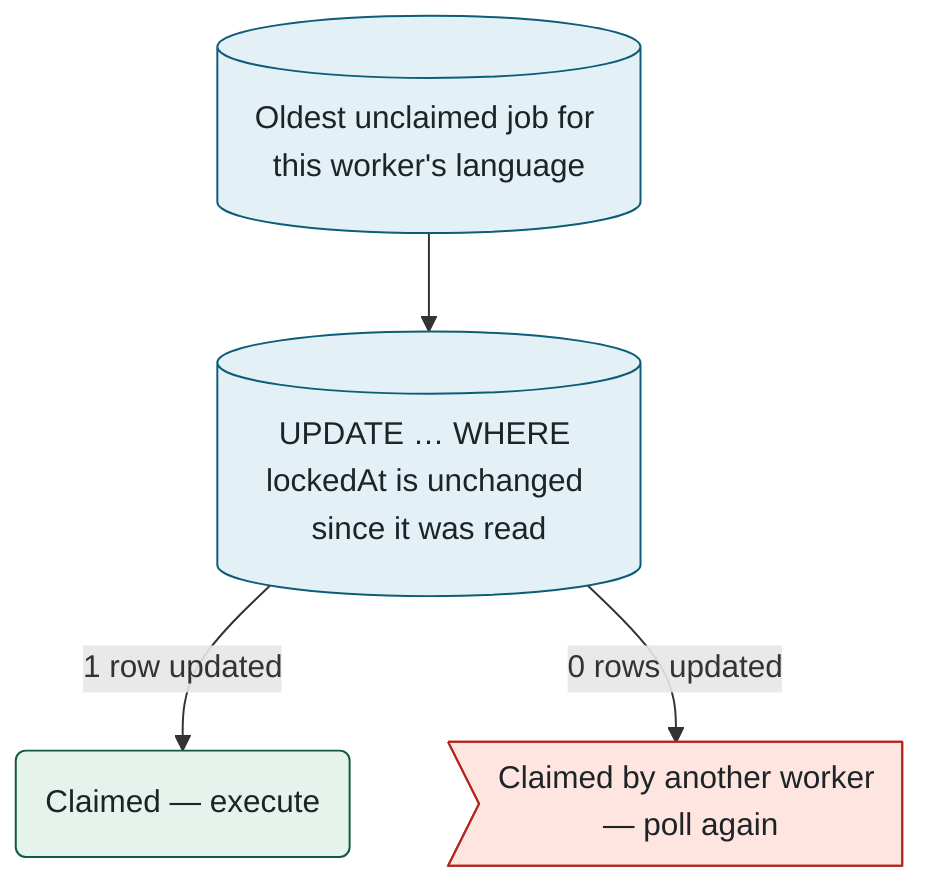
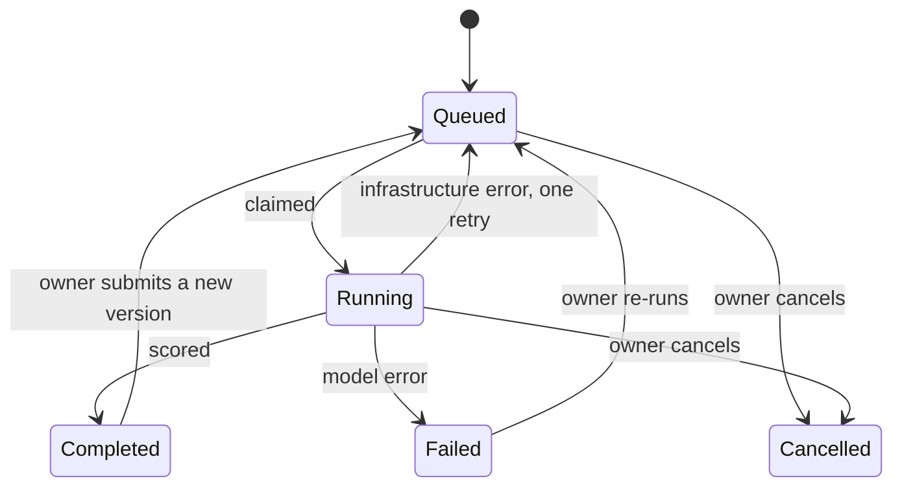

<a id="part-4"></a>
## 4. The life of a submission

> **In this chapter.** The path of a package from the browser to the leaderboard: upload to the web host, validation, queueing, atomic claiming by a worker, sandboxed execution with an anti-forgery check, storage and reporting, and the handling of failure.

### 4.1 Overview


### 4.2 The stages in detail

#### Stage 1 · Upload

The browser posts the form and the archive to the web host in one HTTPS request. The host accepts a form body of the upload limit plus a margin (the limit is 50 MB), checks the archive, and writes it to its own disk under a random key; the database row records the key and never the file. Figure 4.2 shows the exchanges and the one that follows later, when the worker fetches the package.


1. The browser posts the form with the archive and any attachments (diagram, write-up). An anonymous request is redirected to the sign-in page before anything is read.
2. The server action validates everything (Stage 2) and, on success, stores the archive in the package store, `/var/lib/socbench/uploads`, and the attachments beside it, each under a key of the form `<timestamp>-<random>.<ext>`.
3. When a worker claims the job it requests the package from `/api/internal/storage` with a bearer token that only the two machines hold (Section 9.6). After the evaluation it uploads the result traces through the same endpoint and, unless the package is shared, deletes it.

The storage module behind this has three modes, selected by one variable: files on the local disk (development, and the web host in production), a private object bucket with browser-direct uploads through single-use signed URLs (the arrangement used on the former hosted services, kept in the code but unused), and *remote*, in which a worker on another machine reads and writes the web host's local store through the endpoint. The same route serves the test-run panel, under a different key prefix.

#### Stage 2 · Validation

The form is handled by one **server action**, a function that runs on the web server when the form is posted. It performs every check in order of cost, so that the expensive step of unpacking the archive is reached only by requests that have already passed the free ones. Figure 4.3 lays the gate out.


1. **Signed in?** The session cookie is verified.
2. **Under the daily limit?** One database count of the user's submissions in the last 24 hours. Three is the default, editable by an administrator; administrators are exempt.
3. **Form valid?** The model name (at most 50 characters), description (80 to 2000 characters), type, links, privacy and sharing flags, contest and author fields are checked against the same rules the browser applied. The name and the description are then searched for the names of the submitter, the named author and every co-author, whole words only, case-insensitively; a match is refused with a message that quotes it.
4. **Attachments safe?** A diagram or write-up is accepted only if its first bytes are those of a PNG, JPEG, WebP or PDF file, whatever its declared type, and only within 3 MB and 10 MB respectively.
5. **Archive safe?** The archive's table of contents is inspected without unpacking. It is rejected if it has more than 500 entries, would exceed 512 MB unpacked, contains any entry over 256 MB, contains a path with `..` or an absolute path, or has any entry whose compression ratio exceeds 200 to 1 (the signature of a decompression bomb).
6. **Layout right?** There must be no sub-directories, and exactly one of `Model.py`, `Model.m` or `Model.p` at the top level. A MATLAB file is additionally checked for the required function signature. The unpacked total of every file is recorded as the model size shown on the leaderboard.

The check code is deliberately specific about what it found, because a rejected submission should not need a support request:

```ts
if (n.startsWith("/") || /^[A-Za-z]:/.test(n) || n.split("/").includes(".."))
  problems.push(`Unsafe path in archive: "${e.entryName}".`);
if (size / comp > MAX_RATIO && size > 1024 * 1024)
  problems.push(`"${e.entryName}" has an implausible compression ratio; the package was rejected.`);
```

On any failure the stored files are deleted and the form is redisplayed with the message. On success the `Submission` row and its `EvaluationJob` are created in one write, with the package's language recorded so that only a worker capable of running it will claim it.

#### Stage 3 · Queueing

The researcher is redirected to the submission's page, which polls `GET /api/submissions/{id}/status` every 2.5 seconds. The response is assembled from two tables and nothing else:

- the **job queue**, which gives the submission's position among unclaimed jobs of the same language and an estimated wait derived from recent evaluation times;
- the **worker heartbeats**, one row per worker, refreshed every fifteen seconds with the languages it supports, what it is running, and its last console lines. A worker whose heartbeat is older than a minute is shown as offline.

```json
{ "status": "QUEUED", "runtime": "matlab", "queuePosition": 2, "queueWaitSec": 540,
  "evaluator": { "online": true, "queued": 2, "running": 1, "capacity": 1 } }
```

If no online worker supports the package's language, the page says so rather than showing an estimate that cannot be met.

#### Stage 4 · Claiming

Every worker polls the queue every two seconds. Claiming has to be safe when two workers poll at the same instant, and the platform uses no locking service; the database's own atomic update is enough. The worker reads the oldest unclaimed job for its language, then issues one conditional update: set the lock, but only if the row's lock timestamp is still what was just read. Either exactly one row changes, and the job is this worker's, or zero rows change, and another worker got there first.

```ts
const { count } = await db.evaluationJob.updateMany({
  where: { id: candidate.id, lockedAt: candidate.lockedAt },   // unchanged since we read it
  data:  { lockedAt: new Date(), lockedBy: workerId(), attempts: { increment: 1 } },
});
return count === 1 ? candidate : null;                          // 1 = ours, 0 = someone else's
```



Figure 4.4. Claiming a job by compare-and-swap. One attempt has exactly two outcomes.

Two further rules keep the queue honest:

- Every progress line the model prints refreshes the lock timestamp, so a job that is genuinely running is never mistaken for an abandoned one, however long it takes.
- A lock older than thirty minutes with no progress is treated as abandoned (the worker crashed or lost power) and the job becomes claimable again. Each job is allowed two attempts in total.

#### Stage 5 · Execution

The worker fetches the package, unpacks nothing itself, and starts one Docker container for the run. Figure 4.5 shows exactly what the container is given and what it is denied.


The `docker run` invocation the worker issues, reduced to its essentials:

```sh
docker run --rm -i --name socbench-7f3a \
  --network none \
  --read-only --tmpfs /work:rw,exec,size=2g --tmpfs /tmp:rw,size=512m \
  --cap-drop ALL --security-opt no-new-privileges \
  --user 998:998 --pids-limit 256 --memory 4g --cpus 2 \
  -v /var/lib/socbench/jobs/7f3a/package.zip:/in/package.zip:ro \
  -v /var/lib/socbench/jobs/7f3a/out:/out:rw \
  -v /var/lib/socbench/blind-data/blind_data.mat:/data/blind_data.mat:ro \
  socbench-eval /in/package.zip /out --data /data/blind_data.mat
```

Reading the flags in order:

- `--network none` removes the network interface. The model can read the withheld data, as it must, but has no way to transmit anything. (A MATLAB container is the one exception: it is given a bridged interface for the licence check-out described in Section 9.3, and nothing else changes.)
- `--read-only` with two in-memory `--tmpfs` scratch areas means the container's filesystem cannot be modified except in places that vanish with it.
- `--cap-drop ALL` and `no-new-privileges` remove every Linux capability and forbid escalation, and `--user` runs the process as the worker's own unprivileged account.
- The CPU, memory and process-count limits stop a runaway model from starving the host or the other evaluation.
- The three `-v` mounts are the whole of the container's contact with the host. The worker's environment, which holds the database and mail credentials, is never passed in.
- `-i` keeps the container's standard input open. On it the worker writes one line of JSON holding two things that must not be visible to the model: a random **nonce** for the run and, for MATLAB packages, the 24-hour licence token. Neither appears in the environment or on the command line, where a model could read them from `/proc`.

Inside the container the evaluator takes three precautions that were added after the security review of October 2026 (Section 7.4):

1. The model runs in a **separate child process**. The evaluator reads the nonce from its standard input and removes it from its own environment before the model is imported, so the model's process never holds it.
2. The evaluator stamps the nonce into `results.json`. A model that writes its own perfect `results.json` and exits cannot know the nonce, so the worker rejects the file, records a security event and e-mails the administrators.
3. A short **validation run** on one cycle precedes the full evaluation, and a model whose output is constant over that cycle (the signature of a package written for a different calling convention) fails within seconds with an explanation, instead of scoring as a poor model after a long run.

Everything the container writes to its console is appended to the job's log row, which is what the submission page shows as the live console and what refreshes the lock. The worker also samples the container's memory and CPU every few seconds and keeps the series; the peak memory becomes the leaderboard's *Peak RAM* column, and administrators can see the whole series on the submission page. A timeout (twelve hours by default, changeable by an administrator) and the owner's **Cancel** button both stop the container, and stopping it also ends any MATLAB process inside.

#### Stage 6 · Storage and reporting

When the container exits, the worker reads `results.json` from the output directory and proceeds through a fixed sequence. The order matters: the package is deleted only after the result is safely stored, and the e-mail is sent only after the package is gone.

1. **Verify.** The nonce must match the one issued for this run; all eighteen metrics must be finite numbers; and the weighted score is recomputed from the active weights as a cross-check against the evaluator's own figure.
2. **Store the traces.** The full-resolution traces file goes to the web host's store through the private endpoint, replacing the previous one if this is a re-evaluation. The file holds every run at one sample per second, with one deliberate omission: the reference state of charge of the withheld m448 cell is not in it (Section 5.5).
3. **Commit.** The result row is written (or updated) and the submission is marked complete in a single **transaction**, a group of database writes that either all succeed or all fail. A partial result can never be visible.
4. **Record history.** A `ScoreRevision` entry is appended with the score, the metrics, the evaluator version and the complete evaluator console of this attempt, so the result can be reconstructed, and a failure diagnosed, after any later re-scoring or resubmission.
5. **Delete the package**, unless its authors asked to share it. From this point no copy of a non-shared model exists anywhere in the platform. A shared package stays in the store and is served to anyone who can see the submission, with each download logged and rate-limited.
6. **Report.** The PDF is generated and e-mailed to the owner and every confirmed co-author.

The line the worker appends to the job log when it is done is the one to look for when watching a job from the workers page:

```
completed — weighted error 2.401 %
```

### 4.3 Timing


### 4.4 States and transitions



Figure 4.7. Every state a submission can occupy, and the events that move it between them.

A failure attributable to the package (an exception, an invalid return value, a constant output, a forged result, or a timeout) is final, and the error message is stored verbatim for the author. A failure attributable to the infrastructure (the container runtime unavailable, or a defect in the worker) is retried once. Stopping a worker returns its current job to the queue without consuming an attempt. A new version of a completed submission replaces its shared package, if any, and its result when the new evaluation completes; the history keeps both.

**Files to open:** [submit/actions.ts](../../src/app/(app)/submit/actions.ts) → [package-check.ts](../../src/lib/package-check.ts) → [validation.ts](../../src/lib/validation.ts) → [run-job.ts](../../src/evaluator/run-job.ts) → [python-evaluator.ts](../../src/evaluator/python-evaluator.ts).

