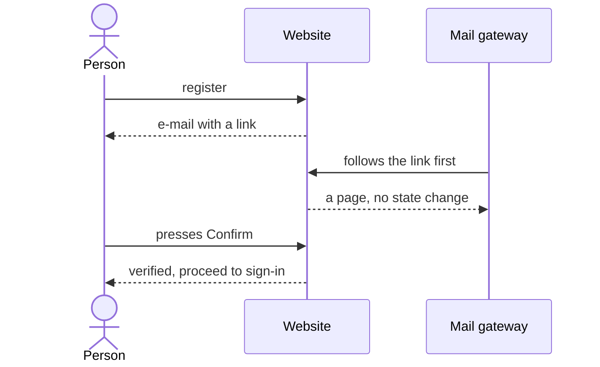

## 7. Accounts and security

> **In this chapter.** Authentication and session handling, the reason e-mail verification requires an explicit action, the layered controls that contain a hostile submission, and the security test suite that exercises them.

### 7.1 Why verification requires a button

Corporate mail-security gateways follow every link in an incoming message before the recipient opens it. When the verification link itself performed the verification, these gateways consumed the single-use token and the recipient found it already invalid. The current design separates the two steps:

1. The link in the e-mail leads to a page and changes nothing.
2. The account is verified only when the person presses the **Confirm** button on that page.

In Figure 7.1 the gateway's visit is the third message; the account's state does not change until the person acts.

Figure 7.1. Verification is robust to mail gateways because following the link has no side effect.

### 7.2 Authentication and sessions

Sign-in follows four rules:

1. **Attempt limits.** An account may attempt sign-in ten times per fifteen minutes, and a network address forty times, after which further attempts are refused for the remainder of the window.
2. **Password storage.** Passwords are stored as **bcrypt** hashes, a deliberately slow one-way function: a single verification is imperceptible, but an exhaustive guessing attack is impractical.
3. **Sessions.** A successful sign-in issues a signed **session token** held in a browser cookie and valid for fourteen days. Requests are authenticated by verifying the signature, without a database lookup.
4. **Authorisation.** Routes under `/submit`, `/profile` and `/admin` redirect unauthenticated visitors before rendering, but this is a convenience only. The authoritative check is repeated inside every server action.

### 7.3 Containing a hostile submission

Secrets are held in exactly four locations: the web host's settings file (`/etc/socbench/web.env`, readable by root and the service account), the worker's settings file (`/etc/socbench/worker.env`, readable by the service account alone), the worker's MATLAB identity token beside it, and one GitHub repository secret for the health check. They appear in no repository file, container image, log or e-mail. The remaining threats, and the control that addresses each, are set out in the table below.

| Threat | Control |
|---|---|
| The model exfiltrates the withheld data | The container has read access (it must) but no network interface, and is destroyed after the run |
| The model attacks the host | Read-only filesystem, no capabilities, CPU and memory limits, execution as an unprivileged user |
| The model reads the worker's secrets | The container does not inherit the worker's environment; the nonce and the MATLAB licence token arrive on standard input and are removed before the model is imported |
| The model forges its own result | The model runs in a separate process; a results file without the per-run nonce is rejected, the attempt fails, and the administrators are alerted |
| The site leaks the answer key | The reference state of charge of the m448 cell is never written to a trace file, a chart, a download or the PDF; the maintenance scripts that purged older traces are in `scripts/` |
| A decompression bomb or a path-traversal entry | Limits on entry count, unpacked size and compression ratio; no sub-directories; no `..` components; checked in the web tier and again in the evaluator |
| A disguised attachment | A diagram or write-up is accepted only if its first bytes are those of PNG, JPEG, WebP or PDF, within fixed size limits |
| The model never terminates | A timeout enforced both inside and outside the container |
| Queue flooding | Three submissions per day and five test runs per hour per account; shared-package downloads are rate-limited and logged |
| Password guessing | bcrypt hashing and the attempt limits above |
| Account enumeration | Password-reset and resend-verification requests respond identically whether or not the address exists |
| A compromised administrator removes the others | Administrators cannot be deleted until demoted, and no user can change their own role; every administrator is told of every role change |

Browser defences complete the picture: a content security policy that allows scripts from this host and Google Analytics only, HTTP strict transport security, `frame-ancestors 'none'`, and no server banner. Search engines index the public pages only; sign-in, registration, profiles, submission and administrative routes are excluded by the robots rules and by page-level `noindex` directives.

### 7.4 The security test suite

Before the public launch the platform was tested against itself. A `security-tests/` directory of five self-contained harnesses, each with a findings file, is kept in the laboratory's working copy and excluded from the public repository, because its payloads are working attacks:

1. **Exfiltration**: can a submission smuggle a planted secret out through its predictions, its timings or its output? (A synthetic secret stands in for the answer key; the real file is never involved.)
2. **Escape**: can submitted code break container isolation through the network, capabilities, the filesystem or the process table?
3. **API**: a black-box probe of the live site's authorisation, token endpoints and headers.
4. **Score tampering**: can a submission forge or tamper with its recorded score?
5. **Denial of service**: infinite loops, fork bombs, disk filling, and the memory, process and CPU caps, run only against a disposable local sandbox.

Two findings were real and were fixed at the root: a model could write a complete results file and exit with a perfect score (hence the separate process and the nonce), and the full-resolution traces of every result served the withheld cell's reference state of charge to anyone (hence the omission in Section 5.5 and the purge of the stored files). Exfiltration, escape, denial of service and the live API surface produced no exploitable finding. The suites exit non-zero when a finding survives, so they can be re-run after any change to the sandbox.

**Files to open:** [auth.ts](../../src/lib/auth.ts) → [middleware.ts](../../src/middleware.ts) → [(auth)/actions.ts](../../src/app/(auth)/actions.ts) → [rate-limit.ts](../../src/lib/rate-limit.ts) → [python-evaluator.ts](../../src/evaluator/python-evaluator.ts) → [strip-blinded-timeseries.ts](../../scripts/strip-blinded-timeseries.ts).

