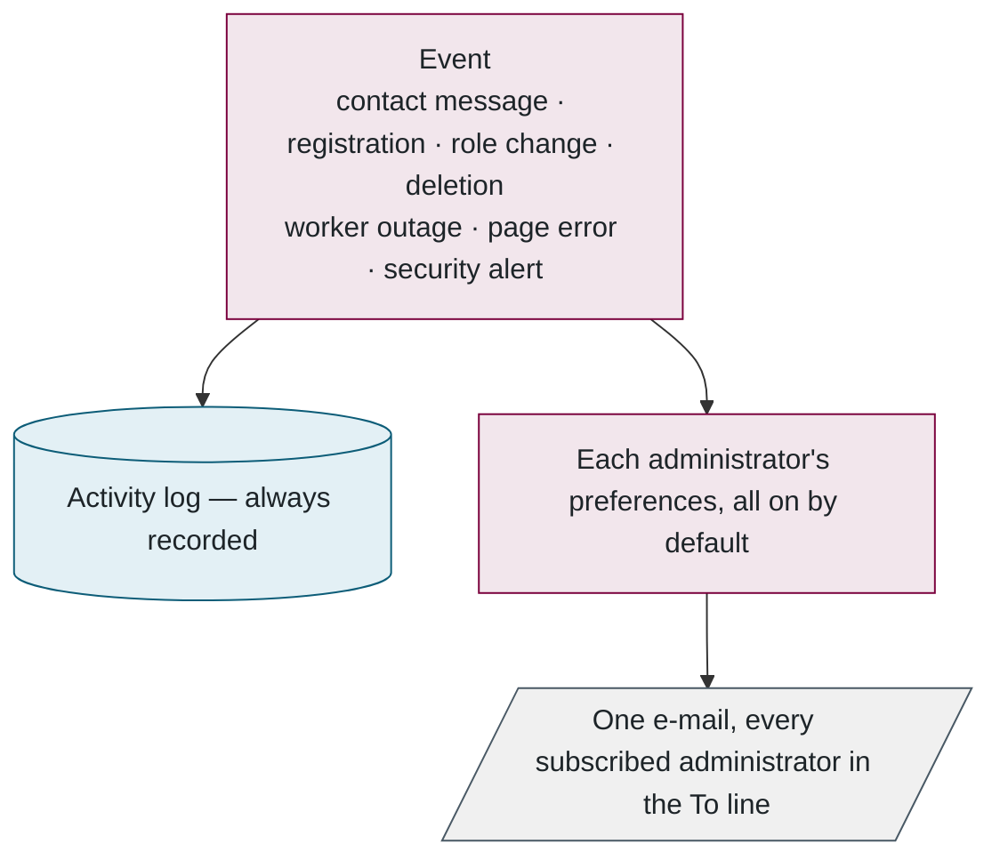
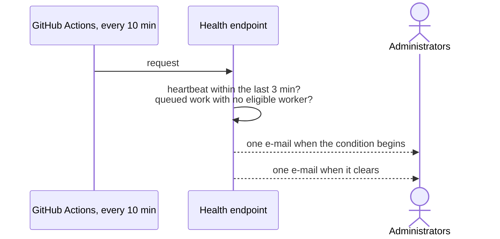

## 8. Administration and monitoring

> **In this chapter.** The administrative interface, the procedure for revising scoring weights without re-evaluating any model, the notification model, the automated check that detects an unreachable worker, and the usage analytics.

### 8.1 The administrative pages

The left-hand navigation enumerates the interface:

- **Overview**: summary counts, recent submissions and the activity log.
- **Analytics**: how the public site is used, read back from Google Analytics (Section 8.5).
- **Submissions**: moderation (private, hidden, delete, each with a written reason that is e-mailed to the authors), retry, bulk deletion, live progress of running evaluations, editing of a submission's name, description, links and authorship, and recording of legacy scores.
- **Contests**: creation with a step rail and readiness checklist, scheduling, duplication, closure and the finalisation of results.
- **Users**: verification, role assignment and deletion, plus the list of named authors credited without an account.
- **Messages**: the contact-form inbox.
- **Evaluation workers**: every registered machine with its load, code revision, Python and MATLAB versions, licence expiry and whether the withheld data is present; the queue; recent failures; the evaluation limits; and a load test that queues several copies of an example in one batch so that the resource charts show the machine under genuine parallel load.
- **Scoring weights**: the subject of Section 8.2.
- **My notifications**: each administrator's own e-mail preferences (Section 8.3).

Every administrative action re-verifies the caller's role before proceeding, and each is subject to a safeguard. The safeguards are tabulated in the appendix.

### 8.2 Revising the weights

An administrator edits the eighteen weights, which must sum to one, previews how many stored scores would change, and saves with a written justification. Every stored result is then re-scored from its persisted per-test metrics; no model is re-executed, since the metrics were retained and the packages were deleted. Authors may optionally be notified of the previous and revised scores with a regenerated PDF. The superseded weights remain in the history.

### 8.3 Notifications

Every administrative event follows two paths, one unconditional and one configurable:

Figure 8.5. The activity log is the record; e-mail is a copy that each administrator may switch off per category.

Seven event classes exist: contact and feedback messages, accounts (registration and verification), administrator changes, submission deletions, worker outages, page errors and security alerts. Every class is on for every administrator unless that administrator switches it off, and one message goes to all of them together, with every recipient in the To line, so each can see who else was told. When administrator rights are granted or revoked, the person concerned is also told directly. The **page errors** class is fed by the site's own error page, which reports itself (reference, address, browser) the moment it renders, throttled to one e-mail per error per hour; a page left open across a deployment reloads itself once instead, and a lost connection on the visitor's side is shown as such and not reported. Every send is logged with a masked recipient and its outcome, so a delivery question can be answered from the server journal.

A note on a property of the former hosting platform, retained because the code still carries its remedy: a serverless request is frozen the instant a response is returned, so any e-mail dispatched asynchronously without being awaited was silently lost. Every such dispatch is wrapped in `after()`, which keeps the request alive until the send completes; on the long-running Node.js process of the Arbutus host it is harmless and still correct.

### 8.4 The outage monitor

The monitor was introduced after an incident in which the worker remained healthy but was unable to reach the database for ten hours, with no indication to anyone. The web tier is the one component that can always observe both the database and the mail service, so it performs the check. A GitHub Actions workflow calls a health endpoint on the site every ten minutes; the endpoint evaluates two conditions and sends an e-mail only when the answer changes.

Figure 8.7. One alert per outage and one all-clear. The state is recorded in the activity log, so it is also visible on the site.

The workflow itself stays green during a worker outage, because the endpoint answers and handles the e-mail; a red run means the website did not answer, which GitHub reports to the repository owner on its own.

### 8.5 Analytics

The public pages report page views, outbound link clicks and opted-in button clicks to a Google Analytics 4 property, and the worker reports evaluation outcomes to the same property through the Measurement Protocol, so that the laboratory can see how the benchmark is used. Nothing is reported until a measurement ID is configured, and a development build uses a separate ID so that local clicks never land in the real property. **Admin → Analytics** reads the property back through the Data API with a read-only service account: people, visits and page views over 7 and 28 days, who is on the site now, the most-viewed pages, how people arrived, countries, devices and every event.

**Files to open:** [admin/actions.ts](../../src/app/(admin)/admin/actions.ts) → [admin-notify.ts](../../src/lib/admin-notify.ts) → [mail.ts](../../src/lib/mail.ts) → [worker-health/route.ts](../../src/app/api/ops/worker-health/route.ts) → [client-error/route.ts](../../src/app/api/ops/client-error/route.ts) → [google-analytics.ts](../../src/lib/google-analytics.ts).

