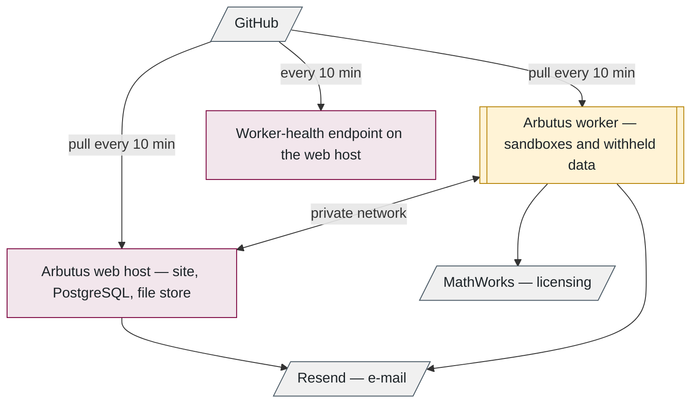
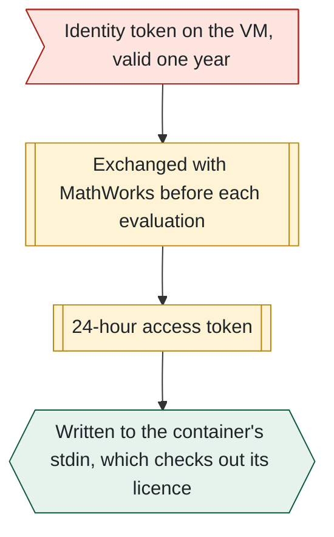

## 9. Infrastructure

> **In this chapter.** The two machines on which the platform runs and how each updates itself, how MATLAB is licensed inside a container, what runs before a push, how the system is run on a development machine, and the self-hosted arrangement and the migration that led to it.

### 9.1 The deployed services

Both deployed programs run on Ubuntu virtual machines in the Alliance's Arbutus cloud and update themselves the same way:

- **The web host** (`socbench-web`) carries Caddy, the Next.js site, PostgreSQL and the package store. Every ten minutes it fetches the repository and, if `main` has moved, installs dependencies if they changed, applies additive schema changes, builds the site beside the running one and swaps them, so that no half-built page is ever served.
- **The worker** (`socbench-eval`) carries Docker, the two sandbox images and the withheld data. Every ten minutes it fetches the repository and, if anything changed, rebuilds only the affected components and restarts the worker, but only when no evaluation is in progress; otherwise it defers to the next interval.

Figure 9.1. The three programs of Chapter 2 in their hosting context. Nothing but GitHub, MathWorks and the mail provider lies outside the research cloud.

A change therefore reaches production by being merged to `main`: the web host adopts it within ten minutes, and the worker within ten minutes of its next idle moment. When a change touches the database schema the web host must update first, since it is the one that applies the schema; the usual practice is to run the two update scripts by hand, web then worker, immediately after the push (Chapter 10).

### 9.2 The worker machine

A single provisioning script prepares the machine. It installs and configures:

- Docker, which provides the sandboxes;
- Node.js, the runtime for the worker;
- a service account with no interactive login, whose sole purpose is to run the worker;
- a checkout of the repository using a deploy key with read-only access;
- a hardened systemd service that keeps the worker running and returns in-flight jobs to the queue on a graceful stop;
- a firewall that admits SSH from the campus network and listed addresses, and nothing else.

Secrets and the withheld data are placed manually after provisioning. They are owned by the service account and readable by no other user. The worker reaches the database over the private network and the package store over HTTPS with its bearer token; it has no public service of its own.

### 9.3 MATLAB in a container

MATLAB runs inside MathWorks' own container image, with Control System Toolbox added by MathWorks' package manager during the image build, and is licensed through the laboratory's MathWorks account rather than a licence server. A one-time interactive sign-in produced an identity token valid for one year, which is stored on the virtual machine. Before each evaluation the worker exchanges it for a 24-hour access token, and only that short-lived token is passed into the container, on standard input, as Figure 9.2 shows:

Figure 9.2. The licensing chain. The long-lived credential never enters the sandbox.

The licence check-out needs to reach MathWorks, so a MATLAB container is started with a bridged network interface instead of none; it is the one relaxation of the sandbox, and restricting that interface to the licensing hosts alone is recorded as open work in the internal runbook. The identity token's expiry date is shown on the workers page; renewal repeats the sign-in.

### 9.4 Checks before a push

Two automated checks protect the site:

- A **pre-push hook** in the repository runs a production build and a Playwright pass over every public page (and a real results page and the comparison page) whenever a push touches the web tier, and refuses the push if any page fails to render, throws in the browser or returns a server error. It runs against the developer's local database.
- The **health workflow** of Section 8.4 runs on GitHub every ten minutes.

There is no separate build server: the two machines build the code themselves on arrival.

### 9.5 Running the system locally

The same code runs on a development machine with different configuration. There is no simulated evaluator: a developer's worker runs the real evaluation pipeline, which requires the withheld data and the sandbox image. The repository README lists the commands required, and the configuration differs from production in four respects:

- a local PostgreSQL instance in Docker on port 5433;
- uploaded files stored under `uploads/` on the local disk, with the worker on the same machine reading them directly;
- e-mail delivered to a throw-away test inbox rather than to real addresses;
- a **seed** script that populates the empty database with one administrator account, one test user and one sample contest, and nothing else.

**Files to open:** [provision-arbutus-worker.sh](../../scripts/provision-arbutus-worker.sh) → [vm-update.sh](../../scripts/vm-update.sh) → [Dockerfile.matlab](../../evaluator/Dockerfile.matlab) → [.githooks/pre-push](.githooks/pre-push) → [.env.example](../../.env.example).

### 9.6 The web host and the migration

The website, the database and the uploaded files share one machine, the **web host**, prepared by one provisioning script that installs and configures:

- Node.js and a hardened systemd service that runs the website on a local port;
- PostgreSQL, listening on the local machine and on the private network only;
- Caddy, a web server that terminates HTTPS and obtains and renews its certificate without intervention;
- a firewall that admits SSH, HTTP and HTTPS from anywhere, and PostgreSQL from the worker's private address alone;
- a nightly database dump retained for fourteen days;
- the self-update timer described in Section 9.1.

The database password and the session secret are generated on the machine during provisioning and are never transmitted elsewhere.

Two machines cannot share a local disk, so package storage has the *remote* mode described in Section 4.2:

1. The website saves an uploaded package to its disk and records the key in the database, exactly as it does on a development machine.
2. The worker claims the job and requests the package from the internal endpoint, presenting the shared token in the request header.
3. After the evaluation the worker uploads the result traces through the same endpoint and, unless the package is shared, deletes it.

The endpoint does not exist unless the token is configured, compares the token in constant time, and accepts only keys of the form the website itself generates, so a request cannot name an arbitrary file.

**The migration.** The platform was launched on commercial free tiers (the website on Vercel, the database and file bucket on Supabase) with the worker already on Arbutus. The move to the arrangement above was carried out on 21 September 2026 in four steps, each a script in the repository: the hosted database was copied into the web host's PostgreSQL with row counts compared table by table; the worker's configuration was repointed to the new database and the remote storage mode; the DNS records were changed and the web host obtained its certificate and rebuilt with the public address; and after a period of parallel running the hosted services were retired on 2 October 2026. One residue remains visible: result traces of ten submissions evaluated before the move were never copied from the former bucket, so those results show no time-series plots and cannot be overlaid on the comparison page.

**Files to open:** [provision-arbutus-web.sh](../../scripts/provision-arbutus-web.sh) → [web-update.sh](../../scripts/web-update.sh) → [storage.ts](../../src/lib/storage.ts) → [internal storage route](../../src/app/api/internal/storage/route.ts) → [cutover-import-db.sh](../../scripts/cutover-import-db.sh).

