# Battery SOC Benchmark — the codebase manual

This manual describes the Battery SOC Benchmark as a complete system: the estimation problem it addresses, the evaluation methodology, the web platform through which models are submitted and ranked, and the software and infrastructure that carry out the evaluation. It is written for two audiences. Researchers, students and collaborators who need to understand what the platform does and why it is designed as it is will find each chapter self-contained at the level of its summary and figures. Developers who intend to maintain or extend the platform should read the chapters in full and open the source files listed in each chapter's summary.

The chapters build on one another and are best read in order on a first pass:

- **Chapters 1 to 3** require no programming background. They cover the state-of-charge estimation problem, the architecture of the platform in outline, and the workflow of a researcher who submits a model.
- **Chapters 4 to 9** describe the system one layer at a time: the evaluation pipeline, the scoring methodology, the data model, security, administration and infrastructure.
- **Chapter 10** is a reference for common maintenance tasks and where each is performed.
- **Chapter 11** is a suggested sequence for demonstrating the platform in ten minutes.
- **The glossary and appendix** collect terminology, configuration, limits and schema details so that the chapters remain readable.

All diagrams share one visual vocabulary, introduced in Section 2.4, so that a given kind of component looks the same on every page. Screenshots show the production site at batterysocbenchmark.ca as of late October 2026; the administrative pages were captured on a seeded development copy.

---

## Contents

1. [The estimation problem](#part-1)
2. [The platform in outline](#part-2)
3. [Using the platform](#part-3)
4. [The life of a submission](#part-4)
5. [Scoring methodology](#part-5)
6. [The data model](#part-6)
7. [Accounts and security](#part-7)
8. [Administration and monitoring](#part-8)
9. [Infrastructure](#part-9)
10. [Maintenance reference](#part-10)
11. [A ten-minute demonstration](#part-11)
12. [Glossary](#part-12)
13. [Appendix: reference tables](#part-13)

---

<a id="part-1"></a>
## 1. The estimation problem

> **In this chapter.** Why the state of charge of a lithium-ion cell must be estimated rather than measured; what drive-cycle data is; how, where and by whom the dataset was produced; how the reference state of charge was established and why it can be trusted; what temperature does to a cell; how estimation error is defined; and why part of the dataset is withheld.

### 1.1 A quantity that cannot be measured

The **state of charge** (**SOC**) of a battery is the fraction of its usable capacity that remains, conventionally expressed as a percentage from 0 to 100. It is the quantity behind the range indicator of an electric vehicle, and it is an input to nearly every other decision a **battery management system** (**BMS**) makes: how much power may be drawn, how fast the pack may be charged, and when the vehicle must be protected from over-discharge. Yet no sensor measures it. What the BMS can observe, at rates of a few hertz, is the terminal current, the terminal voltage and the cell temperature. The state of charge must be inferred from these signals by an **estimator**, an algorithm executed continuously on the vehicle's battery controller.

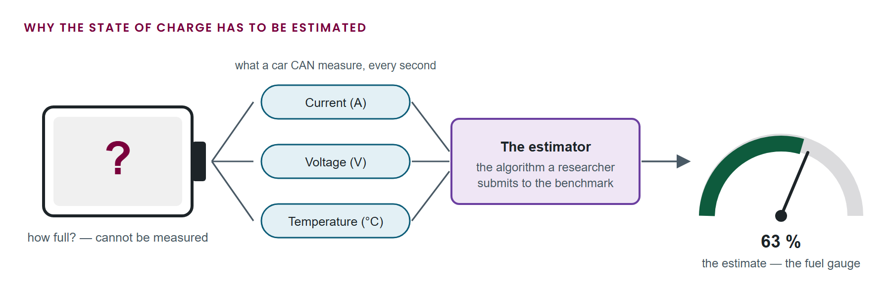

The consequences of estimation error are practical. An estimate that reads high exposes the driver to a battery that is emptier than indicated; one that reads low forces the manufacturer to reserve capacity as a safety margin, capacity the customer has paid for but can never use. Estimators are also notoriously sensitive to operating conditions: an approach that performs well at room temperature may drift severely at sub-zero temperatures, where the cell's internal resistance rises and the relationship between voltage and state of charge flattens. A substantial research literature is therefore devoted to improving estimation methods, ranging from Coulomb counting and Kalman filtering to recurrent and transformer neural networks. This benchmark exists to evaluate those methods on a common footing.

### 1.2 Drive-cycle data

A **drive cycle** is a standardised speed-versus-time profile representing a particular kind of driving. Regulatory bodies have used a small set of them for decades to certify fuel economy and emissions, which makes them well characterised and reproducible. Figure 1.2 shows the four standard cycles the benchmark uses, as published by the United States Environmental Protection Agency:

- **UDDS**, the Urban Dynamometer Driving Schedule, representing stop-and-go city driving.
- **HWFET**, the Highway Fuel Economy Test, representing steady highway driving.
- **LA92** and **US06**, more aggressive profiles with higher speeds, harder acceleration and harder braking.

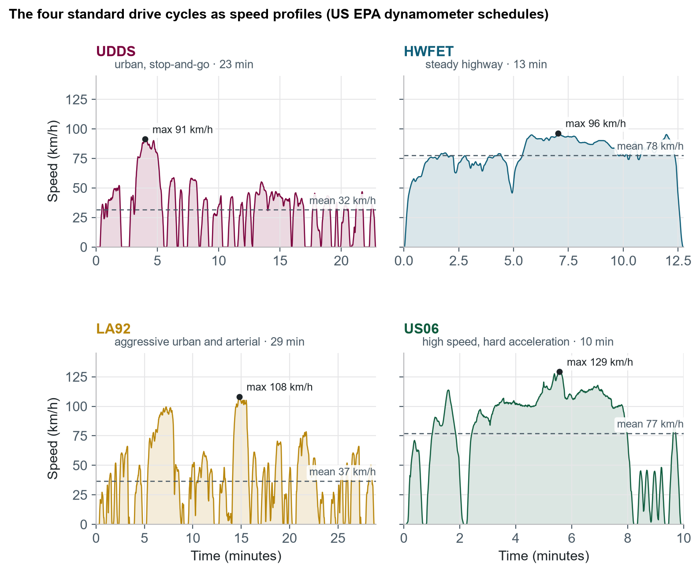

To these the laboratory added its own profiles. Eight **REORDERED** cycles were assembled by splicing randomly ordered segments of the four standard cycles into trips of several hours, so that a model cannot recognise a standard cycle by its shape. Two custom highway cycles, **HWCUST1** and **HWCUST2**, and two highway cycles with varying road grade, **HWGRADE1** and **HWGRADE2**, complete the set. One of each custom pair is published; the other is withheld.

A speed profile on its own says nothing about the battery. To turn it into a battery test, the laboratory used a vehicle model of a Tesla Model 3 standard-range car (50 kWh pack, 1612 kg curb mass) to compute, second by second, the current a single cell in that pack would deliver while following the profile: large discharge currents during acceleration, regenerative charging during braking, and no current at rest. Four cells were each assigned a different vehicle configuration, so that the same drive cycle produces four different current demands:

| Cell | Payload above curb mass | Cabin climate control | Represents |
|---|---|---|---|
| m80 | 80 kg | on | A single occupant |
| m448 | 448 kg | on | A full passenger load |
| m448N | 448 kg | off | A full passenger load, heating and cooling off |
| m1000 | 1000 kg | on | A full load with a trailer |

Figure 1.3 shows what the resulting recording looks like for one cell over one cycle.


### 1.3 How the data was produced

The dataset was produced in the McMaster Energy Storage Laboratory at the McMaster Automotive Resource Centre in Hamilton, Ontario, in 2021. The tests were carried out by Fauzia Khanum and Mina Naguib under the supervision of Dr. Phillip Kollmeyer, and the dataset and the evaluation methodology were published by Kollmeyer, Naguib, Khanum and Ali Emadi at the IEEE Transportation Electrification Conference in 2022. Version 2 of the dataset, with corrected and additional files, was released in July 2026.

The cells are four cylindrical 2170 lithium-ion cells of nickel cobalt aluminium (NCA) chemistry, manufactured by Panasonic for Tesla and taken from a Model 3 battery pack. Their nominal capacity is 4.5 Ah, and each measured approximately 4.7 Ah at the start of testing. Figure 1.4 summarises the equipment chain.

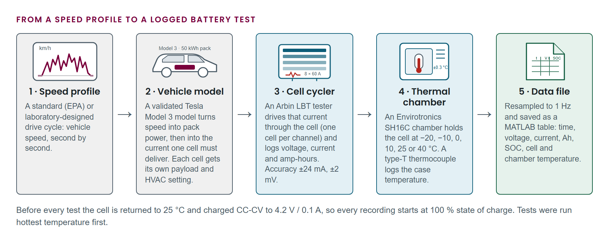

Two instruments did the work. An **Arbin LBT cell cycler** with eight 60 A channels applied the computed current to each cell (one cell per channel) and logged voltage, current and accumulated amp-hours; its stated control accuracy is ±24 mA on the 60 A range and ±2 mV on voltage, and it can log at up to 2000 samples per second. An **Envirotronics SH16C thermal chamber** held the cells at the test temperature to within ±0.3 °C, and a type-T thermocouple on each cell's case recorded its actual temperature. All recordings were resampled to one sample per second before publication.

The test campaign followed a fixed procedure for each cell:

1. Tests were run at 40, 25, 10, 0, −10 and −20 °C, in that order, hottest first.
2. Before every test, the cell was brought back to 25 °C and charged by the constant-current, constant-voltage method to 4.2 V with a 0.1 A cut-off, so that every recording begins from a fully charged cell.
3. At each temperature a set of **characterisation tests** was run first: a slow C/20 discharge at 40 °C to measure capacity, discharges at C/3, C/2 and 1C, a C/20 discharge-and-charge pair, and a hybrid pulse power characterisation (HPPC) test with discharge and charge pulses at every 5 to 10 % of state of charge. These are the tests from which equivalent-circuit and open-circuit-voltage models are parameterised.
4. The **drive cycles** followed: the four standard cycles, the eight REORDERED cycles and the four custom highway cycles, each driven from a full charge down to a cut-off determined from that temperature's HPPC test and a 60 kW vehicle power limit.

Between temperature rounds the cell rested while the chamber changed temperature. The whole campaign for one cell spans about eight months of instrument time, which is why the file names carry dates from April to December 2021.

### 1.4 The reference state of charge

Every score in the benchmark rests on the state-of-charge column in these files, so it matters how that column was obtained and how far it can be trusted. It is not a sensor reading; it is derived from two measured quantities under controlled conditions that a vehicle never enjoys.

The first quantity is the **charge removed**, which the cycler measures by integrating its own current (Coulomb counting) with an instrument whose current error is a few tens of milliamps and which is periodically re-zeroed at full charge. The second is the **capacity** of the cell, the total charge it holds. Capacity is not fixed: it depends on temperature, on the rate of discharge and on the cell's age. The laboratory therefore adopted one fixed definition, a C/20 discharge (a very gentle discharge lasting about twenty hours) performed at 40 °C, and measured it afresh at the start of every temperature round. Figure 1.5 shows one such measurement and how the reference declined over the campaign.


The state of charge in every file is then the fraction of that reference capacity still in the cell. With $I(\tau)$ the measured current in amperes (positive when charging) and $Q_{\mathrm{ref}}$ the reference capacity in ampere-hours,

$$
\mathrm{SOC}(t) = 1 - \frac{Q_{\mathrm{removed}}(t)}{Q_{\mathrm{ref}}}, \qquad Q_{\mathrm{removed}}(t) = -\frac{1}{3600}\int_{0}^{t} I(\tau)\,\mathrm{d}\tau \tag{1.1}
$$


Because the cell ages during a round, the reference capacity is not applied as a single number. It is interpolated linearly between the value measured at the start of the round, $Q^{(n)}$, and the value measured at the start of the next one, $Q^{(n+1)}$, across the twenty-three tests that make up a round:

$$
Q_{\mathrm{ref},k} = Q^{(n)} + \frac{k}{22}\left(Q^{(n+1)} - Q^{(n)}\right), \qquad k = 0, 1, \ldots, 22 \tag{1.2}
$$

For the 25 °C round of the m80 cell, for example, the reference runs from 4.530 Ah for the first test down to 4.453 Ah for the last. The final round at −20 °C has no successor, so its end value was extrapolated from the trend of the three preceding rounds.

This definition has three properties worth understanding. It is **traceable**: the raw amp-hour column is preserved in every file, so anyone can recompute the state of charge from a different capacity definition if their application calls for one. It is **consistent**: the same definition is applied to every cell, temperature and cycle, so an error of 2 % means the same thing everywhere. And it is **not something a vehicle can reproduce**: a car has no laboratory-grade current sensor, no twenty-hour capacity test and no rest periods, which is precisely why an estimator is needed, and why the benchmark's robustness tests (Chapter 5) deliberately corrupt the current signal and the starting point.

### 1.5 Why temperature matters

Figure 1.6 illustrates the single most important effect the dataset captures. The same cell was driven through the same REORDERED1 cycle at each of the six temperatures. At 40 °C the cell delivered 4.51 Ah before reaching the cut-off, close to its full reference capacity. At −20 °C it delivered 2.82 Ah, and the test ended with the reference state of charge still above 30 %, because the cold cell could no longer supply the vehicle's power demand.


The two panels show the two faces of the problem. The slope of each trace is the current draw, which the vehicle model held broadly similar across temperatures; the traces end early in the cold because the cell's internal resistance rises sharply, so the same power demand causes a larger voltage drop and the cut-off is reached sooner. An estimator must track state of charge correctly through this regime, where the relationship between terminal voltage and state of charge that many estimators rely on is at its weakest.

### 1.6 Estimation error

For every sample of every drive cycle the reference state of charge is known from the laboratory measurement described in Section 1.4. The model under test, given only current, voltage and temperature, produces its own estimate for the same sample. The difference between the two is the **estimation error**, and it is the sole quantity the benchmark measures. Every number on the leaderboard is an aggregate of it.


The error over a cycle is summarised by its **root-mean-square error** (**RMSE**). With $\widehat{\mathrm{SOC}}_k$ the model's estimate and $\mathrm{SOC}_k$ the reference at sample $k$ of a cycle of $N$ samples,

$$
\mathrm{RMSE} = \sqrt{\frac{1}{N}\sum_{k=1}^{N}\left(\widehat{\mathrm{SOC}}_k - \mathrm{SOC}_k\right)^{2}}, \qquad \mathrm{MAE} = \frac{1}{N}\sum_{k=1}^{N}\left|\widehat{\mathrm{SOC}}_k - \mathrm{SOC}_k\right| \tag{1.3}
$$

The mean absolute error (MAE) and the maximum absolute error are reported alongside it but do not enter the score. RMSE penalises large excursions more heavily than a mean absolute error would. A model that is consistently 2 % high scores an RMSE of 2 %; a model that is exact for most of a cycle but wrong by 20 % for a few minutes scores considerably worse. This weighting is deliberate, since in a vehicle a bounded, predictable error is far more useful than an occasional large one.

The conditions under which error occurs matter as much as its magnitude. A model that is accurate at 25 °C but drifts at −20 °C is of limited use in a cold climate, and a model that is accurate only when initialised with the exact starting state of charge is of limited use in a vehicle, which does not know it. The scoring methodology therefore does not simply average error over the dataset. It reports error separately by cell, temperature and cycle type, and it includes two deliberate perturbations: an incorrect initial state of charge and a constant bias on the current measurement. Chapter 5 sets out the full methodology.

### 1.7 Open and withheld data

Publishing the entire dataset and inviting groups to report their own results would not produce comparable numbers. Each group would select its own test cycles and its own error definition, and a model trained on published data can memorise it and appear far better than it is. The benchmark addresses both problems with a held-out evaluation set.

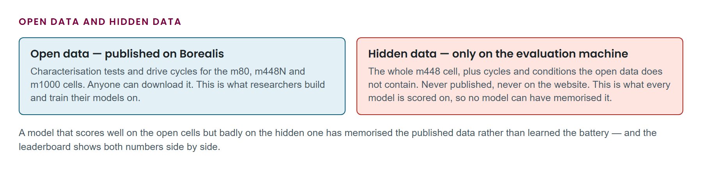

The **open dataset**, published on the Borealis research data repository under a Creative Commons Attribution licence, contains the m80, m448N and m1000 cells: every characterisation test, the eight REORDERED cycles and one of each custom highway pair at every temperature. Researchers develop and train on it without restriction. The **withheld dataset** (referred to in the code as the *blinded* data) contains the four standard cycles for every cell, the second cycle of each custom pair, the whole of the m448 cell, and the charging profiles. It has never been published and it never touches the web tier. Every submitted model is scored on the withheld data, and the leaderboard reports the withheld-cell error beside the open-cell error. A model that performs well on the open cells and poorly on the withheld one has fitted the published data rather than learned the underlying behaviour, and the comparison makes this visible.

One consequence shapes every plot on the site. The reference state of charge of the m448 cell *is* the answer key, so it is never served: results pages, downloads and the PDF report show the m448 cell's **error** against time, but never its reference state-of-charge trace. Section 5.5 and Section 7.3 return to this.

### 1.8 What the benchmark provides

The benchmark provides a single, fixed evaluation: the same withheld data, the same evaluation code, the same error definition and the same published weights for every model. A researcher packages an estimator as a single Python or MATLAB function together with its parameter files, uploads the package, and receives within minutes to a few hours a weighted score, a per-test breakdown, per-cycle traces, every figure of the laboratory's original evaluation script, and a PDF report. The score is placed on a public leaderboard where it is directly comparable with every other entry. The uploaded package is deleted as soon as it has been evaluated, unless its authors have chosen to share it (Section 3.3).

---

<a id="part-2"></a>
## 2. The platform in outline

> **In this chapter.** The five stages from open data to leaderboard, the three programs that implement them, the architectural rule that protects the withheld data, and where each component is hosted.

### 2.1 Five stages

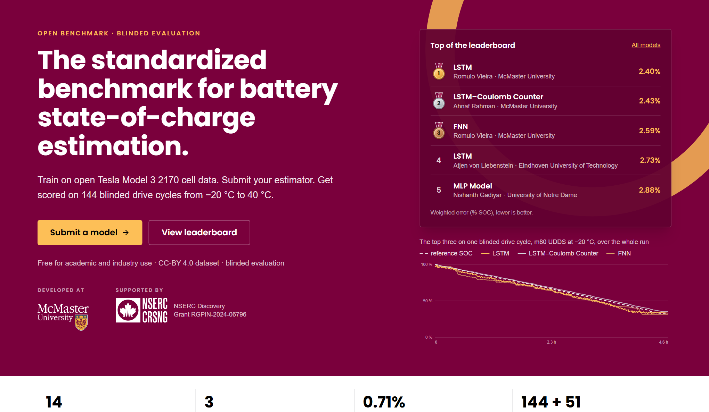

The platform reduces to five stages, and its credibility rests on the separation between the first and the fourth:

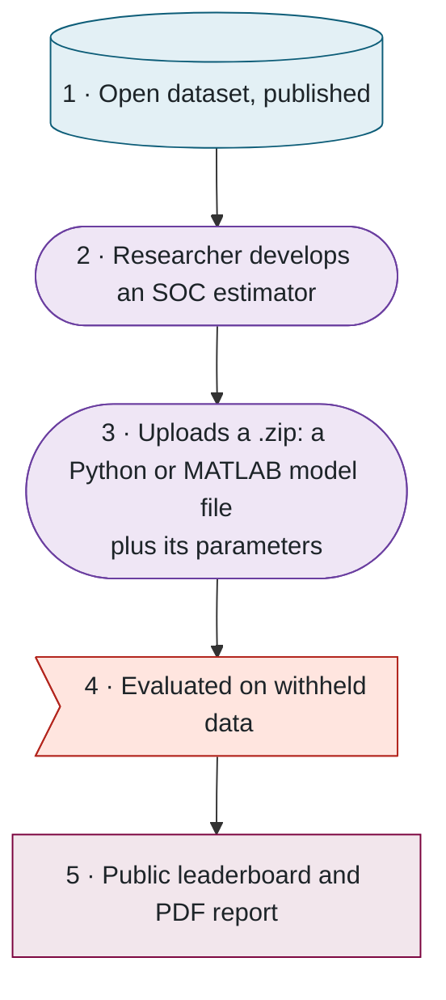

Figure 2.2. The five stages. Stage 1 is public and stage 4 is confidential; the benchmark's validity depends on keeping them apart.

### 2.2 Three programs and one rule

Behind the website are three separate programs, and the architecture follows from one rule:

> **The web tier never executes submitted code and never has access to the withheld data.**

The three programs divide the work as follows:

- **The website** serves pages and forms, records submissions, stores uploaded files on its own disk, and shows results. It reads and writes the database and nothing else.
- **The worker** is a separate machine under the laboratory's control. It holds the withheld data, claims queued submissions, fetches each package from the website, and runs each evaluation.
- **The sandbox** is an isolated container the worker starts for every evaluation: no network access, a read-only filesystem, discarded when the run ends. It is the only place a submitted model is ever executed.

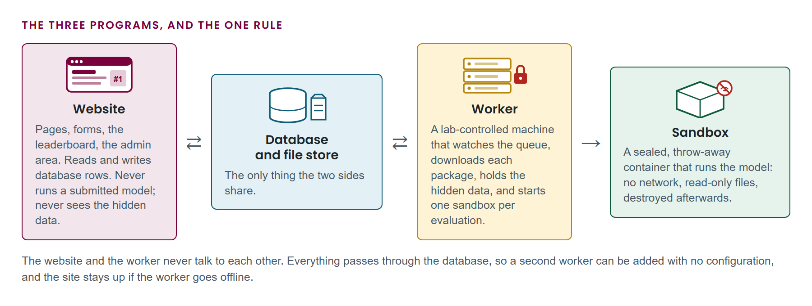

The website and the worker never communicate directly; all coordination passes through the database, and the only other channel is a private file endpoint through which the worker fetches a package and returns its result traces (Section 9.6). Three consequences of this recur throughout the manual:

1. An additional worker can be added with no configuration, since it simply begins claiming jobs.
2. The website remains fully available when no worker is reachable, as it did during a ten-hour network outage in September 2026.
3. The job queue is an ordinary database table rather than a separate message-queue service.

### An analogy: the sealed examination

The arrangement is easier to remember as the way a university runs a written examination. Figure 2.4 draws the comparison.


- **The registrar's office is the website.** Candidates enrol, hand in a sealed script, and later read their mark on the noticeboard. The clerks never open a script and have never seen the answer key.
- **The filing room is the database.** The registrar drops each script in the IN tray; the examiner collects it from there and returns the mark to the DONE tray. The two never meet, so a second examiner can start work simply by collecting from the same tray.
- **The locked marking room is the worker.** It holds the only copy of the answer key. Nobody but the examiner enters, and the examiner never leaves with it.
- **The sealed exam booth is the sandbox.** The script is answered against the key one at a time, in a booth with no phone and no window, and is shredded the moment it has been marked. Nothing that happens in the booth can reach the outside, and nothing is kept.

A submitted model is the candidate. It is given the questions (the withheld drive cycles), writes its answers (the estimates), and is marked against the key (the reference state of charge). It never sees the key, and no copy of it survives the examination. The one exception is at the candidate's own request: an author who ticks *Share the model files* asks the registrar to keep a copy of the script in the public reading room, which is the only case in which a package outlives its evaluation.

### 2.3 Where the components are hosted

Since 21 September 2026 the whole platform runs on two virtual machines in the **Arbutus** cloud of the Digital Research Alliance of Canada, so that nothing is paid for and every part of it, including the withheld data, stays on machines the laboratory controls. Figure 2.5 shows the two machines and the three outside services they depend on. (From launch until that date the website ran on Vercel with the database on Supabase; Section 9.6 records the move.)

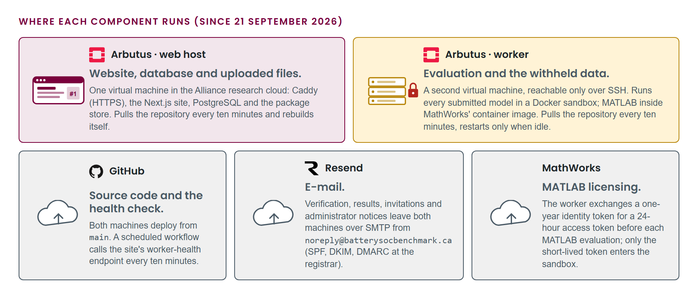

### 2.4 Visual conventions

Every diagram in this manual uses one icon, one colour and one shape for each kind of thing, so a component looks the same on every page. The pictures use the icons; the flow diagrams, which are drawn with a diagramming tool that cannot show icons, use the shapes and colours. Figure 2.6 is the key to both.

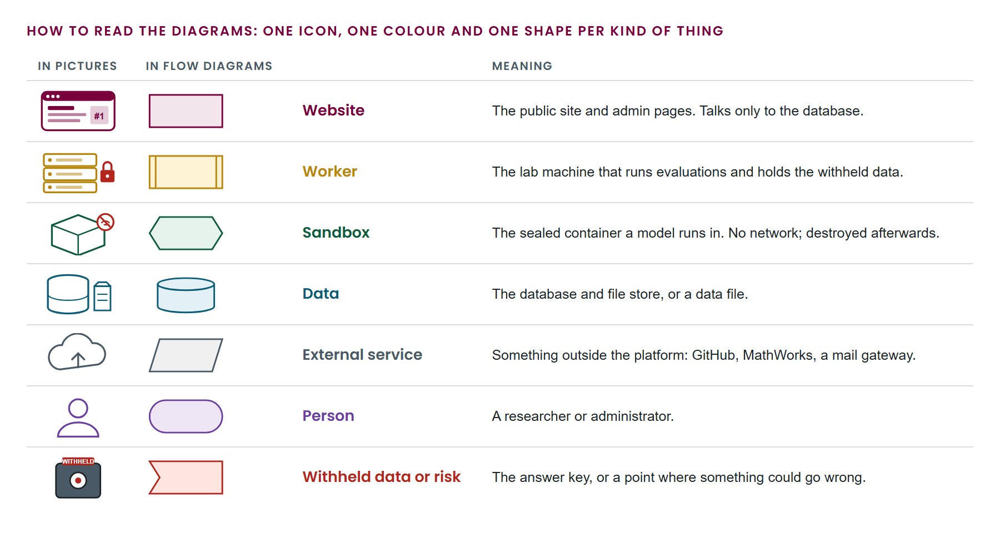

**Files to open:** [README.md](../../README.md) → [prisma/schema.prisma](../../prisma/schema.prisma) → [src/evaluator/worker.ts](../../src/evaluator/worker.ts).

---

<a id="part-3"></a>
## 3. Using the platform

> **In this chapter.** The workflow of a researcher, page by page: registering an account, validating a package before submission, the three-step submission form, interpreting the results page tab by tab, the leaderboard and the comparison page, and the pages that document the benchmark itself.

### 3.1 Registration

Registration is a four-step process:

1. The form asks for a name, an institutional affiliation, an e-mail address and a password.
2. A confirmation e-mail follows. Opening its link displays a page with a **Confirm** button.
3. Pressing that button verifies the account. Section 7.1 explains why the link alone is not sufficient.
4. The verified user signs in, and the session remains valid for fourteen days.

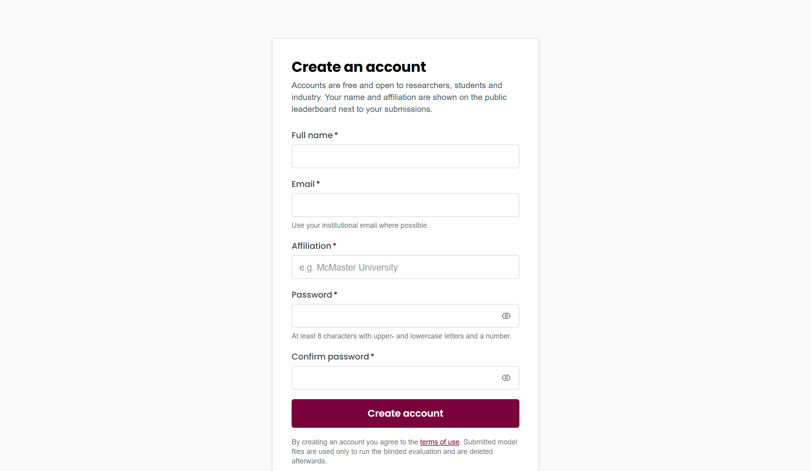

A signed-in user also has a public **researcher profile** (occupation, biography, website, and ORCID, Google Scholar, ResearchGate, GitHub and LinkedIn identifiers, each shown with its brand icon) and a profile picture, resized in the browser to a small JPEG before it is uploaded. The profile page lists the person's public models.

### 3.2 Validating a package before submission

Each account is limited to three submissions per day, so it is worth validating a package before spending one. The submission form's first step holds the **test run** control: once a zip has been chosen, pressing **Run test** executes the package through the real evaluator on one *public* drive cycle (cell m80, profile REORDERED1, 25 °C, two hours). The model's console output streams onto the page, and the error on that cycle is reported when it completes. A test run is not recorded anywhere public and does not involve the withheld data. Its purpose is to catch the defects that would otherwise waste a submission:

- a model file that is missing or incorrectly named,
- a parameter file the model attempts to load but the package does not contain,
- a model function that returns a value of the wrong shape or outside the interval 0 to 1,
- a model written for a different calling convention, which returns a constant and is rejected within seconds.

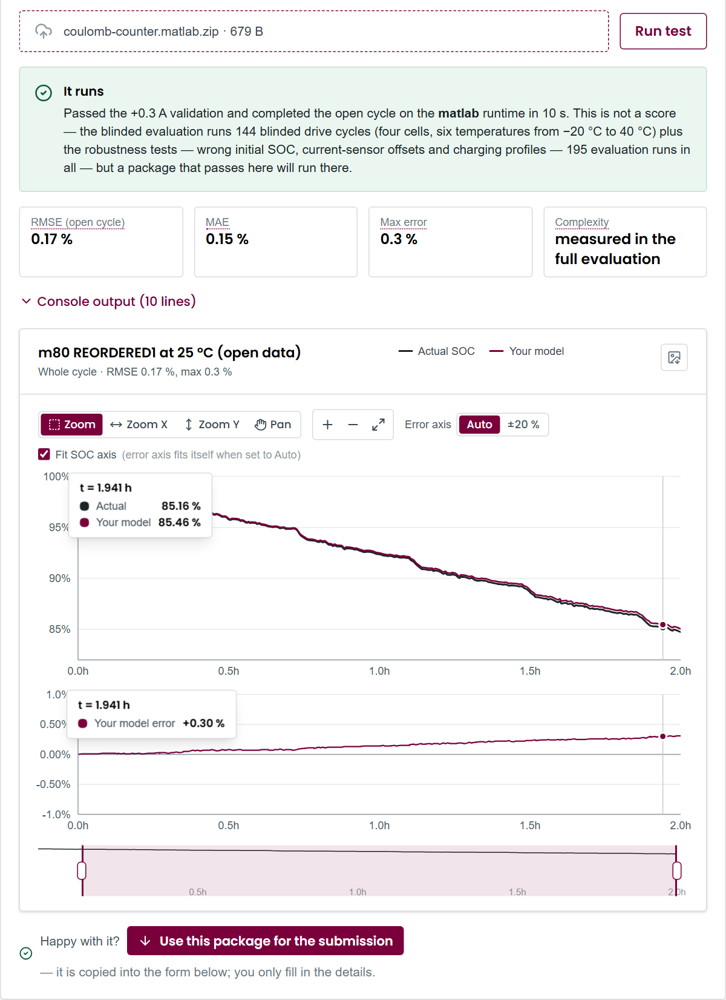

The package format is deliberately minimal:

- All files are placed at the top level of the archive, with no sub-directories.
- Exactly one file is the model: `Model.py` for Python, or `Model.m` or `Model.p` for MATLAB.
- Any parameter files the model loads (`.mat`, `.npz` and similar) are placed alongside it.

Section 5.1 specifies the model function's interface. Four reference packages (a Coulomb counter, an extended Kalman filter, a feed-forward network and an LSTM, each in both languages) can be downloaded from the **Examples** page or run as a test with one click.

### 3.3 Submission

The submission page is organised as three numbered steps, with the package checklist and a description of what happens next in the margin.

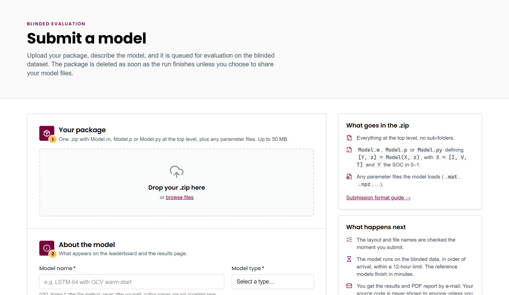

**Step 1, the package.** One `.zip` of at most 50 MB, dropped onto the page or chosen from disk, with the test run described above available immediately.

**Step 2, about the model.** This is what the leaderboard and the results page show, and it is the part of the form that the laboratory asked to be made substantive (issue tracker, October 2026), because a leaderboard of entries named "LSTM" with one-line descriptions does not tell a reader what was done:

- a **model name** of up to 50 characters, named after the method and never after a person;
- the **model type** (Coulomb counter, extended or unscented Kalman filter, feed-forward, LSTM or GRU network, transformer, physics-based, hybrid, or other);
- a **description** of 80 to 2000 characters. The field asks for the inputs, the model structure (equations, network layers, filter states), what the model was trained or fitted on, and what sets it apart from a textbook version. A description or model name that contains the name of the submitter, of the person it is submitted for, or of any co-author is refused with a message that quotes the match: the authors are listed beside the model already, and the description is for the model;
- an optional **Paper** link (DOI, arXiv or publisher) and an optional **Code** link (a public repository);
- an optional **model diagram** (PNG, JPEG or WebP, up to 3 MB) and an optional **write-up** (PDF, up to 10 MB).

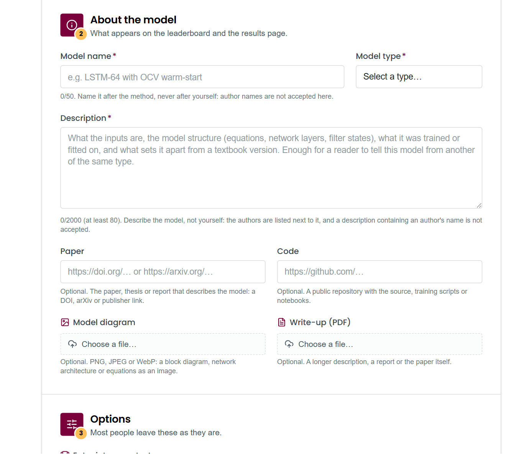

**Step 3, options.** Most submitters leave these as they are:

- **Share the model files.** Off by default, in which case the package is deleted the moment the evaluation finishes. On, the package is kept and anyone who can see the submission gets a *Model files* download button on its page, plus a *files* badge on the leaderboard. An owner can stop sharing later, which deletes the package; a package that was not shared cannot be shared afterwards, because it no longer exists.
- **Private.** The model is evaluated and shown to its authors with a provisional rank, but does not appear on the public leaderboard.
- **Contest.** Enter the model into the contest that is currently open, if any (Section 3.6).
- **Submit on someone's behalf.** The uploader can name the actual author, either an existing account or a person without one (name, affiliation and an optional photo), and can choose whether to be listed too. Permissions, e-mail and later versions stay with the uploader; the credit goes to the named author.
- **Co-authors.** Account holders chosen from a picker. Each receives an invitation and is listed publicly only after accepting it.

The form is validated in the browser with the same rules the server applies, so an error is reported before the upload begins. Once a package has been submitted, the page shows its position in the queue, an estimated start time and whether a worker capable of running the package's language is currently online. When evaluation begins, the page switches to a live progress indicator with the stage and the remaining time.

### 3.4 Interpreting results

The results page opens with three cards and continues as a set of tabs, so that the headline figures are read first and the detail is reached deliberately.

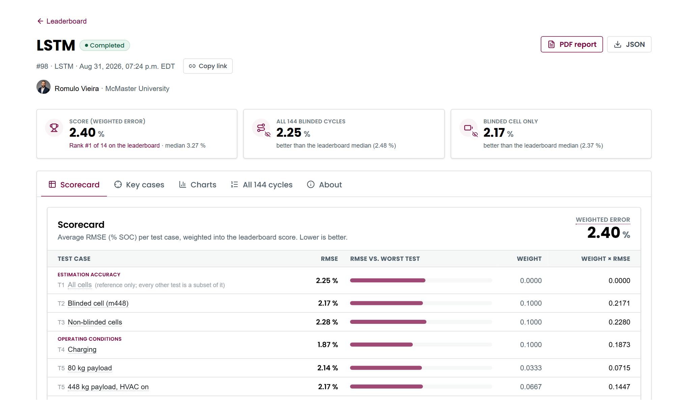

**The three cards.** The score (weighted error) with the model's rank and the leaderboard median; the RMSE over all 144 withheld cycles; and the RMSE on the withheld m448 cell alone. The last two carry the crossed-eye badge that marks withheld data throughout the site, and each states whether the figure is better or worse than the leaderboard median, so a reader knows at once whether the model generalises to the cell it has never seen.

**Scorecard.** The eighteen test cases with the RMSE, a bar scaled to the model's worst test, the weight and the product of the two. The products sum to the weighted error at the head of the table, so the derivation of the score is fully visible.

**Key cases.** The cycles that most differentiate estimators (the temperature extremes, the withheld cell, the worst cycle and the robustness runs), each plotted against the measured state of charge with interactive zoom and pan.

**Charts.** The scorecard as charts, followed by every figure the laboratory's original MATLAB evaluation script produced, in the script's order:

- *Error by test case*, with each bar labelled by what the case is (payload, cycle type, temperature, robustness) rather than by a test number;
- *Where the weighted error comes from*, a donut of each test group's weight × RMSE as a share of the score, which shows where an improvement would move the rank most;
- the figure gallery: withheld versus open cell (tests 1 to 3), driving versus charging (test 4), the three payloads on UDDS (tests 5 and 6), standard versus non-standard highway cycles (tests 7 and 8), RMSE against temperature with UDDS at −20, 0 and 40 °C (test 9), the 90, 60 and 30 % starts overlaid per cycle and aligned on their common end (test 10), and the ±0.3 A offsets overlaid per cycle with RMSE against every offset swept (test 11). Each panel has SOC above, error below and the RMSE in its legend, and every panel carries icon chips naming the payload, HVAC state, cycle type, chamber temperature and robustness test, so that the plots can be told apart at a glance. Every figure can be downloaded as a PNG.

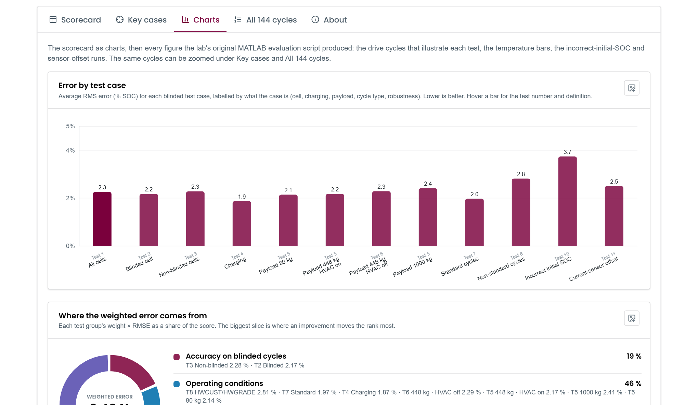

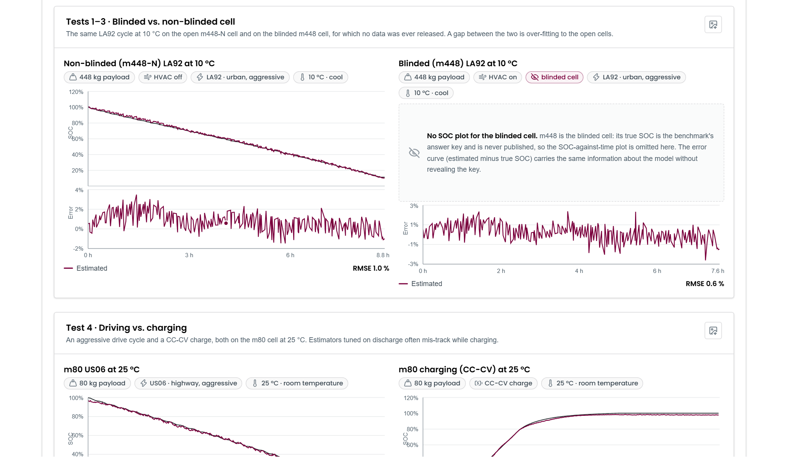

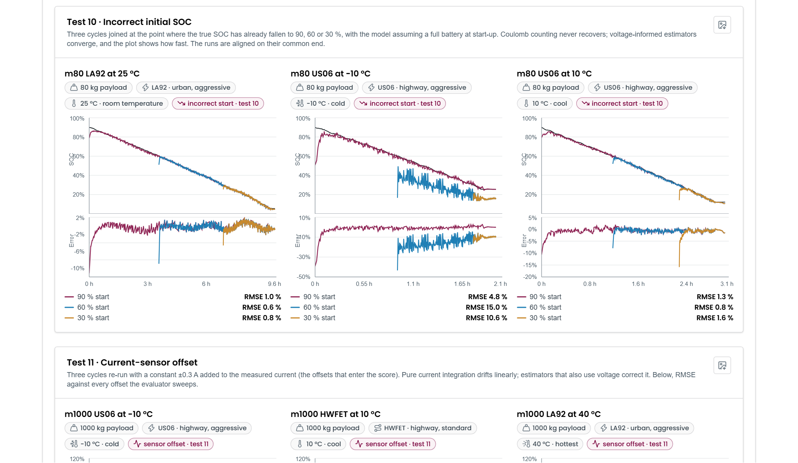

**All 144 cycles.** The per-cycle table with RMSE, mean absolute error, maximum error and duration, sortable and filterable.

**History.** Every revision of the result (evaluation, re-evaluation, re-score, failure, cancellation), shown to the submission's authors and to administrators. Administrators also see, per attempt, the full evaluator console as it was at the time, so that a failure can be diagnosed long after the job's live log has been replaced by a resubmission.

**About.** The description, the diagram and write-up if any, the Paper and Code buttons, the package row (name, unpacked and zipped size, whether the files are shared, and a download button when they are), the evaluator version, and the downloads: the PDF report, the results as JSON and, for the authors, the full-resolution traces.

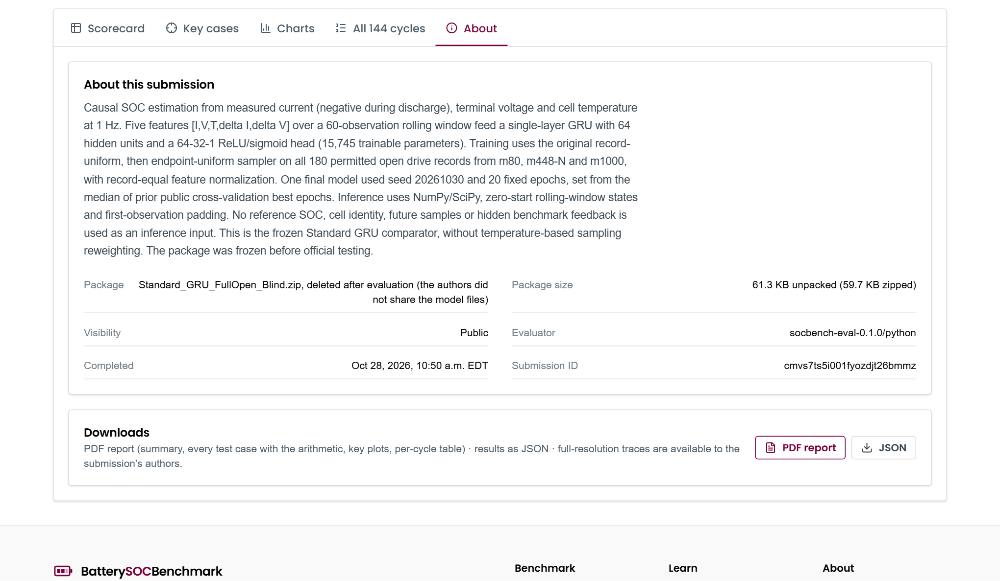

The **PDF report**, regenerated on request, contains the summary with every test case as bars and the donut, the scorecard with its arithmetic, the key plots, a grid of all 144 cycles shaded by error, the score history, and an appendix of per-cycle errors. It is also attached to the results e-mail.

### 3.5 The leaderboard

The leaderboard ranks every public, completed model by weighted error in ascending order; the first three carry gold, silver and bronze medals. Ties are broken by the all-cells error and then by submission time. The table offers:

- filters by author, affiliation and model type;
- the default columns Model, Author, Submitted, Weighted error, Complexity, All cells, Blinded cell, Max error, **Model size** (the uncompressed total of every file inside the package, recorded at submission; entries uploaded before this was recorded show the zipped size, marked as such) and **Peak RAM** (the peak memory of the model process during evaluation, measured in the sandbox, which includes the MATLAB or Python runtime);
- further columns through the **Columns** control: the per-temperature and robustness cases, the description, and more;
- a *files* badge on any row whose package is shared;
- one horizontal scrollbar, placed above the column headers so that the sideways scroll is visible without scrolling to the foot of the page; the Model column stays pinned while scrolling;
- a **How to read this table** panel, export as **CSV**, and a link from each model to its results page.

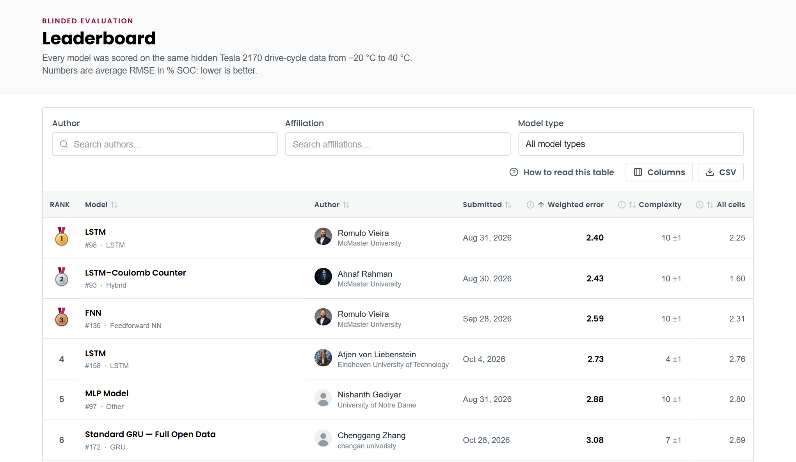

A signed-in user's private models are shown to that user with a dashed provisional rank, indicating the position the model would occupy, without displacing any public entry. Results produced by an earlier version of the scoring code remain listed but unranked, and their authors are invited to resubmit. Scores that predate the platform can be recorded by an administrator as **legacy** entries, which carry a badge, have no package and are never mistaken for a run of this evaluator.

**Compare.** The comparison page overlays two to four models: every test case side by side with the best value in each row marked, the error-by-test-case bars, error against temperature, and any withheld cycle as a time-domain overlay. For the *worst case* of a model the page now overlays the same cycle from each of the other models (October 2026); the withheld m448 cell is the one cycle that cannot be overlaid, because its reference trace is never served.

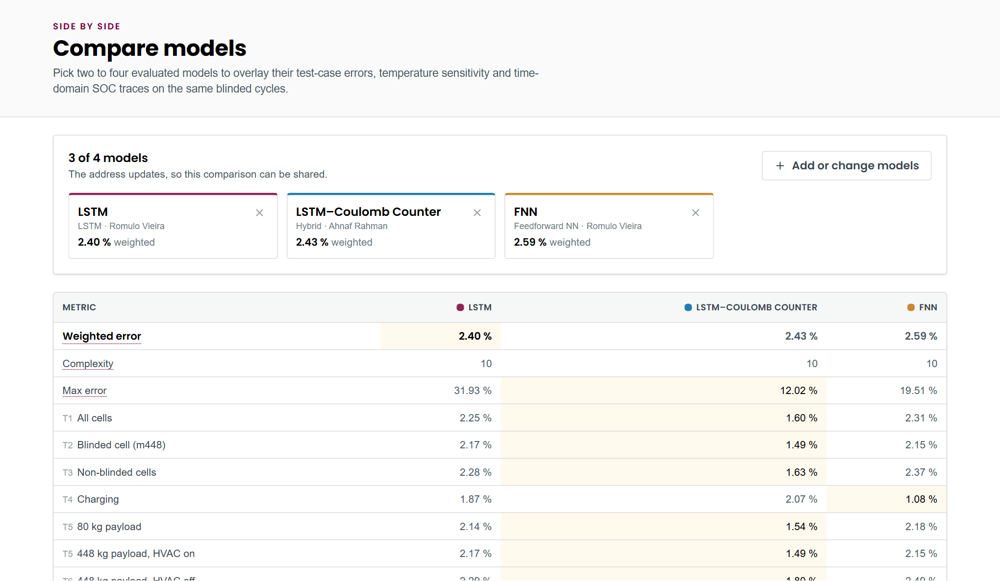

### 3.6 Co-authors, named authors and contests

A **co-author** with an account is invited by e-mail and must accept by pressing a button on the invitation page; only then is the co-author listed publicly and included in result notifications. A **named author** without an account (credited by the uploader at submission, or by an administrator afterwards) is listed everywhere the model appears, with an optional photo, but has no profile page and receives no e-mail. Administrators can reassign ownership, add and remove co-authors and decide whether the uploader is shown as lead author, as a co-author or not at all; one helper, `publicAuthors`, is the single source of the author list for the leaderboard, the results page, the PDF, the share image and the researcher profiles.

A **contest** is a time-bounded event with its own leaderboard, frozen at the closing date. A contest passes through phases derived from its dates (upcoming, open, judging, judged), all in Toronto time; it carries prize rows, an eligibility statement that entrants confirm, an entry limit per person, a team size, optionally a restriction to one language, and a registration deadline. Contest entries must remain public, and their name and model type are fixed once the contest closes. When the results are finalised the winners are recorded on the contest page and each is e-mailed.

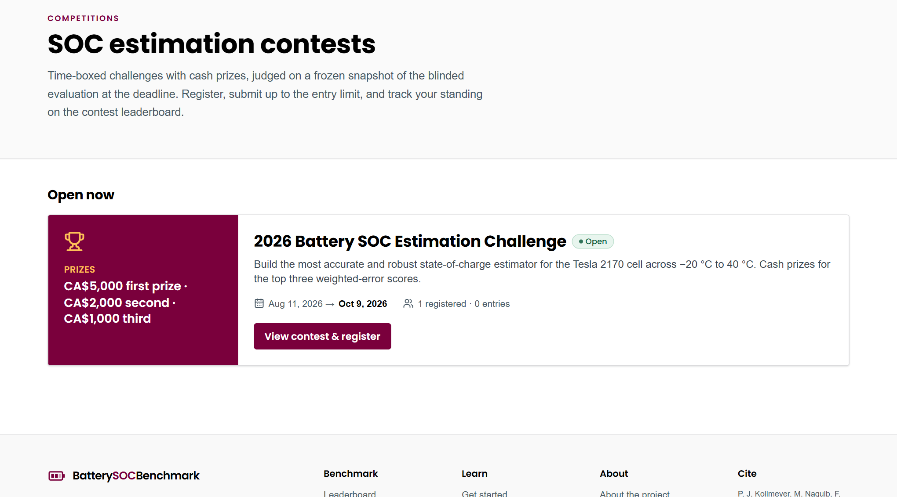

### 3.7 The documentation pages

Under **Learn** the site documents itself: *Get started* (the walkthrough from account to result), *Example models* (the eight reference packages), *Dataset* (the four cells, the open-versus-withheld table and the file format, using the same icons as the result plots), *Methodology* (the model interface, the eighteen tests and the weights, with the equations), *Glossary* and *Help & FAQ*. **About** describes the project, the laboratory with a link to battery.mcmaster.ca, and the people behind it.

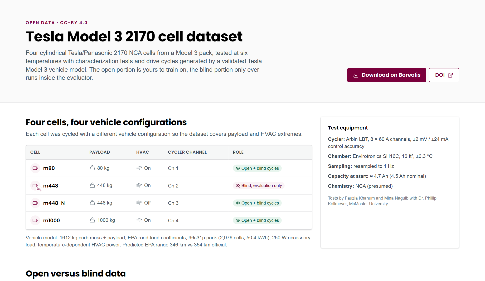

**Files to open:** [submit-form.tsx](../../src/app/(app)/submit/submit-form.tsx) → [dry-run-panel.tsx](../../src/app/(app)/submit/dry-run-panel.tsx) → [submissions/[id]/page.tsx](../../src/app/(app)/submissions/[id]/page.tsx) → [figure-gallery.tsx](../../src/components/charts/figure-gallery.tsx) → [leaderboard-table.tsx](../../src/components/leaderboard/leaderboard-table.tsx) → [authors.ts](../../src/lib/authors.ts).

---

<a id="part-4"></a>
## 4. The life of a submission

> **In this chapter.** The path of a package from the browser to the leaderboard: upload to the web host, validation, queueing, atomic claiming by a worker, sandboxed execution with an anti-forgery check, storage and reporting, and the handling of failure.

### 4.1 Overview


### 4.2 The stages in detail

#### Stage 1 · Upload

The browser posts the form and the archive to the web host in one HTTPS request. The host accepts a form body of the upload limit plus a margin (the limit is 50 MB), checks the archive, and writes it to its own disk under a random key; the database row records the key and never the file. Figure 4.2 shows the exchanges and the one that follows later, when the worker fetches the package.

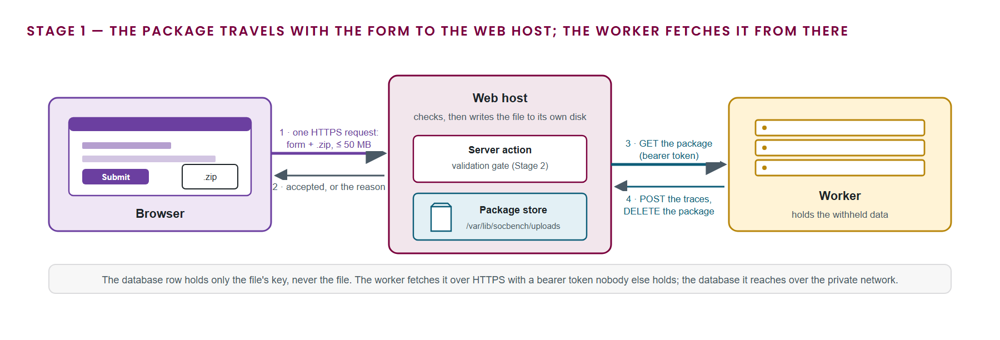

1. The browser posts the form with the archive and any attachments (diagram, write-up). An anonymous request is redirected to the sign-in page before anything is read.
2. The server action validates everything (Stage 2) and, on success, stores the archive in the package store, `/var/lib/socbench/uploads`, and the attachments beside it, each under a key of the form `<timestamp>-<random>.<ext>`.
3. When a worker claims the job it requests the package from `/api/internal/storage` with a bearer token that only the two machines hold (Section 9.6). After the evaluation it uploads the result traces through the same endpoint and, unless the package is shared, deletes it.

The storage module behind this has three modes, selected by one variable: files on the local disk (development, and the web host in production), a private object bucket with browser-direct uploads through single-use signed URLs (the arrangement used on the former hosted services, kept in the code but unused), and *remote*, in which a worker on another machine reads and writes the web host's local store through the endpoint. The same route serves the test-run panel, under a different key prefix.

#### Stage 2 · Validation

The form is handled by one **server action**, a function that runs on the web server when the form is posted. It performs every check in order of cost, so that the expensive step of unpacking the archive is reached only by requests that have already passed the free ones. Figure 4.3 lays the gate out.

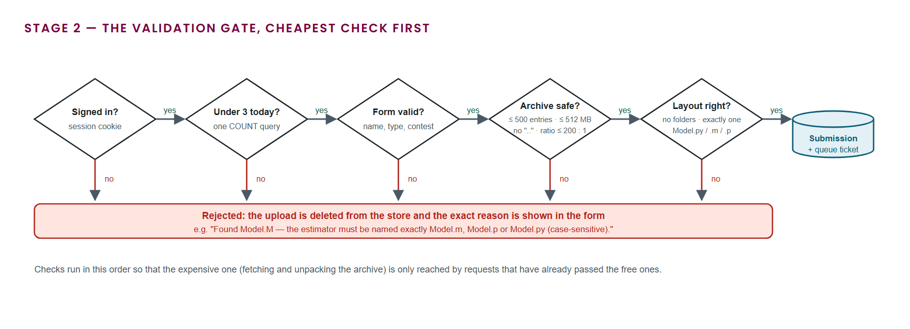

1. **Signed in?** The session cookie is verified.
2. **Under the daily limit?** One database count of the user's submissions in the last 24 hours. Three is the default, editable by an administrator; administrators are exempt.
3. **Form valid?** The model name (at most 50 characters), description (80 to 2000 characters), type, links, privacy and sharing flags, contest and author fields are checked against the same rules the browser applied. The name and the description are then searched for the names of the submitter, the named author and every co-author, whole words only, case-insensitively; a match is refused with a message that quotes it.
4. **Attachments safe?** A diagram or write-up is accepted only if its first bytes are those of a PNG, JPEG, WebP or PDF file, whatever its declared type, and only within 3 MB and 10 MB respectively.
5. **Archive safe?** The archive's table of contents is inspected without unpacking. It is rejected if it has more than 500 entries, would exceed 512 MB unpacked, contains any entry over 256 MB, contains a path with `..` or an absolute path, or has any entry whose compression ratio exceeds 200 to 1 (the signature of a decompression bomb).
6. **Layout right?** There must be no sub-directories, and exactly one of `Model.py`, `Model.m` or `Model.p` at the top level. A MATLAB file is additionally checked for the required function signature. The unpacked total of every file is recorded as the model size shown on the leaderboard.

The check code is deliberately specific about what it found, because a rejected submission should not need a support request:

```ts
if (n.startsWith("/") || /^[A-Za-z]:/.test(n) || n.split("/").includes(".."))
  problems.push(`Unsafe path in archive: "${e.entryName}".`);
if (size / comp > MAX_RATIO && size > 1024 * 1024)
  problems.push(`"${e.entryName}" has an implausible compression ratio; the package was rejected.`);
```

On any failure the stored files are deleted and the form is redisplayed with the message. On success the `Submission` row and its `EvaluationJob` are created in one write, with the package's language recorded so that only a worker capable of running it will claim it.

#### Stage 3 · Queueing

The researcher is redirected to the submission's page, which polls `GET /api/submissions/{id}/status` every 2.5 seconds. The response is assembled from two tables and nothing else:

- the **job queue**, which gives the submission's position among unclaimed jobs of the same language and an estimated wait derived from recent evaluation times;
- the **worker heartbeats**, one row per worker, refreshed every fifteen seconds with the languages it supports, what it is running, and its last console lines. A worker whose heartbeat is older than a minute is shown as offline.

```json
{ "status": "QUEUED", "runtime": "matlab", "queuePosition": 2, "queueWaitSec": 540,
  "evaluator": { "online": true, "queued": 2, "running": 1, "capacity": 1 } }
```

If no online worker supports the package's language, the page says so rather than showing an estimate that cannot be met.

#### Stage 4 · Claiming

Every worker polls the queue every two seconds. Claiming has to be safe when two workers poll at the same instant, and the platform uses no locking service; the database's own atomic update is enough. The worker reads the oldest unclaimed job for its language, then issues one conditional update: set the lock, but only if the row's lock timestamp is still what was just read. Either exactly one row changes, and the job is this worker's, or zero rows change, and another worker got there first.

```ts
const { count } = await db.evaluationJob.updateMany({
  where: { id: candidate.id, lockedAt: candidate.lockedAt },   // unchanged since we read it
  data:  { lockedAt: new Date(), lockedBy: workerId(), attempts: { increment: 1 } },
});
return count === 1 ? candidate : null;                          // 1 = ours, 0 = someone else's
```

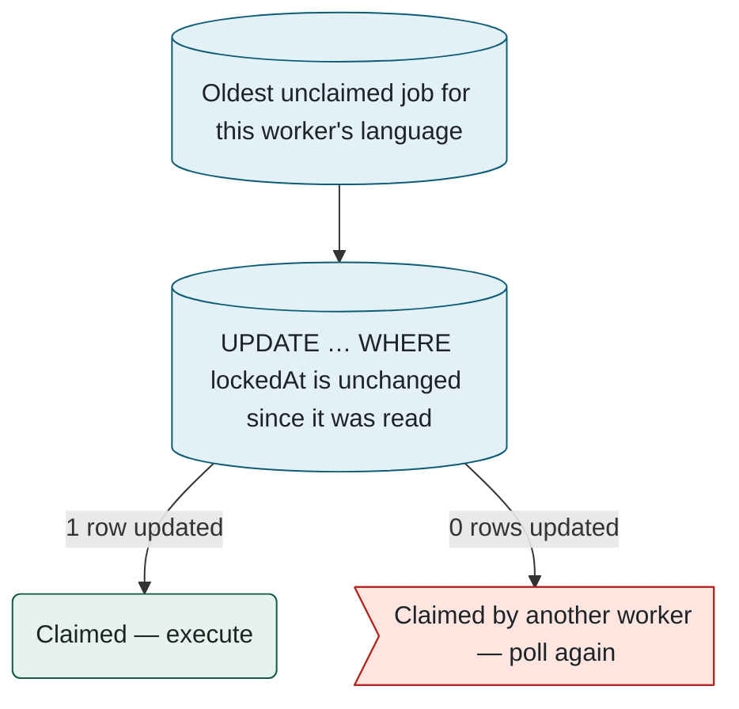

Figure 4.4. Claiming a job by compare-and-swap. One attempt has exactly two outcomes.

Two further rules keep the queue honest:

- Every progress line the model prints refreshes the lock timestamp, so a job that is genuinely running is never mistaken for an abandoned one, however long it takes.
- A lock older than thirty minutes with no progress is treated as abandoned (the worker crashed or lost power) and the job becomes claimable again. Each job is allowed two attempts in total.

#### Stage 5 · Execution

The worker fetches the package, unpacks nothing itself, and starts one Docker container for the run. Figure 4.5 shows exactly what the container is given and what it is denied.

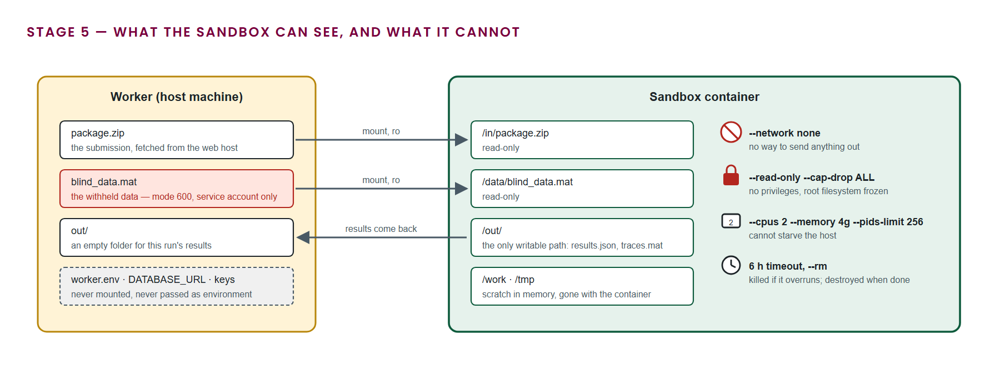

The `docker run` invocation the worker issues, reduced to its essentials:

```sh
docker run --rm -i --name socbench-7f3a \
  --network none \
  --read-only --tmpfs /work:rw,exec,size=2g --tmpfs /tmp:rw,size=512m \
  --cap-drop ALL --security-opt no-new-privileges \
  --user 998:998 --pids-limit 256 --memory 4g --cpus 2 \
  -v /var/lib/socbench/jobs/7f3a/package.zip:/in/package.zip:ro \
  -v /var/lib/socbench/jobs/7f3a/out:/out:rw \
  -v /var/lib/socbench/blind-data/blind_data.mat:/data/blind_data.mat:ro \
  socbench-eval /in/package.zip /out --data /data/blind_data.mat
```

Reading the flags in order:

- `--network none` removes the network interface. The model can read the withheld data, as it must, but has no way to transmit anything. (A MATLAB container is the one exception: it is given a bridged interface for the licence check-out described in Section 9.3, and nothing else changes.)
- `--read-only` with two in-memory `--tmpfs` scratch areas means the container's filesystem cannot be modified except in places that vanish with it.
- `--cap-drop ALL` and `no-new-privileges` remove every Linux capability and forbid escalation, and `--user` runs the process as the worker's own unprivileged account.
- The CPU, memory and process-count limits stop a runaway model from starving the host or the other evaluation.
- The three `-v` mounts are the whole of the container's contact with the host. The worker's environment, which holds the database and mail credentials, is never passed in.
- `-i` keeps the container's standard input open. On it the worker writes one line of JSON holding two things that must not be visible to the model: a random **nonce** for the run and, for MATLAB packages, the 24-hour licence token. Neither appears in the environment or on the command line, where a model could read them from `/proc`.

Inside the container the evaluator takes three precautions that were added after the security review of October 2026 (Section 7.4):

1. The model runs in a **separate child process**. The evaluator reads the nonce from its standard input and removes it from its own environment before the model is imported, so the model's process never holds it.
2. The evaluator stamps the nonce into `results.json`. A model that writes its own perfect `results.json` and exits cannot know the nonce, so the worker rejects the file, records a security event and e-mails the administrators.
3. A short **validation run** on one cycle precedes the full evaluation, and a model whose output is constant over that cycle (the signature of a package written for a different calling convention) fails within seconds with an explanation, instead of scoring as a poor model after a long run.

Everything the container writes to its console is appended to the job's log row, which is what the submission page shows as the live console and what refreshes the lock. The worker also samples the container's memory and CPU every few seconds and keeps the series; the peak memory becomes the leaderboard's *Peak RAM* column, and administrators can see the whole series on the submission page. A timeout (twelve hours by default, changeable by an administrator) and the owner's **Cancel** button both stop the container, and stopping it also ends any MATLAB process inside.

#### Stage 6 · Storage and reporting

When the container exits, the worker reads `results.json` from the output directory and proceeds through a fixed sequence. The order matters: the package is deleted only after the result is safely stored, and the e-mail is sent only after the package is gone.

1. **Verify.** The nonce must match the one issued for this run; all eighteen metrics must be finite numbers; and the weighted score is recomputed from the active weights as a cross-check against the evaluator's own figure.
2. **Store the traces.** The full-resolution traces file goes to the web host's store through the private endpoint, replacing the previous one if this is a re-evaluation. The file holds every run at one sample per second, with one deliberate omission: the reference state of charge of the withheld m448 cell is not in it (Section 5.5).
3. **Commit.** The result row is written (or updated) and the submission is marked complete in a single **transaction**, a group of database writes that either all succeed or all fail. A partial result can never be visible.
4. **Record history.** A `ScoreRevision` entry is appended with the score, the metrics, the evaluator version and the complete evaluator console of this attempt, so the result can be reconstructed, and a failure diagnosed, after any later re-scoring or resubmission.
5. **Delete the package**, unless its authors asked to share it. From this point no copy of a non-shared model exists anywhere in the platform. A shared package stays in the store and is served to anyone who can see the submission, with each download logged and rate-limited.
6. **Report.** The PDF is generated and e-mailed to the owner and every confirmed co-author.

The line the worker appends to the job log when it is done is the one to look for when watching a job from the workers page:

```
completed — weighted error 2.401 %
```

### 4.3 Timing

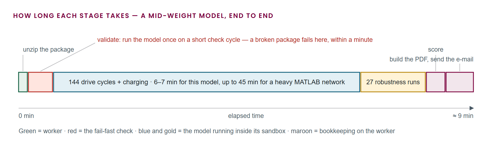

### 4.4 States and transitions

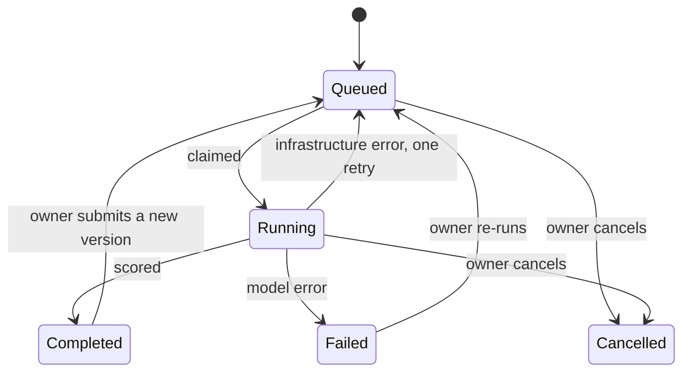

Figure 4.7. Every state a submission can occupy, and the events that move it between them.

A failure attributable to the package (an exception, an invalid return value, a constant output, a forged result, or a timeout) is final, and the error message is stored verbatim for the author. A failure attributable to the infrastructure (the container runtime unavailable, or a defect in the worker) is retried once. Stopping a worker returns its current job to the queue without consuming an attempt. A new version of a completed submission replaces its shared package, if any, and its result when the new evaluation completes; the history keeps both.

**Files to open:** [submit/actions.ts](../../src/app/(app)/submit/actions.ts) → [package-check.ts](../../src/lib/package-check.ts) → [validation.ts](../../src/lib/validation.ts) → [run-job.ts](../../src/evaluator/run-job.ts) → [python-evaluator.ts](../../src/evaluator/python-evaluator.ts).

---

<a id="part-5"></a>
## 5. Scoring methodology

> **In this chapter.** The model interface, the composition of the evaluation set, the aggregation of per-cycle errors into eighteen test cases and one weighted score, the two auxiliary quantities reported alongside it, and what leaves the sandbox.

The evaluator is approximately 800 lines of Python. It reimplements the laboratory's original MATLAB blind-modelling tool and reproduces its results to three decimal places on the reference models.

### 5.1 The model interface

A model is a single function invoked once per sample, in the same manner as an estimator running on a vehicle's battery controller. At each call it receives the current, voltage and temperature for that sample together with whatever state it returned from the previous call, and it returns its estimate and the state to carry forward. It has no access to future samples. The simplest admissible model is a Coulomb counter, which integrates the measured current over the rated capacity $Q$ (here 4.6 Ah) at the one-second sample interval $\Delta t$:

$$
\widehat{\mathrm{SOC}}_k = \widehat{\mathrm{SOC}}_{k-1} + \frac{I_k\,\Delta t}{3600\,Q}, \qquad \widehat{\mathrm{SOC}}_0 = 1 \tag{5.1}
$$

In code it is four lines:

```python
def Model(X, z=None):          # X = [current, voltage, temperature]
    current = float(X[0])
    soc = 1.0 if z is None else float(z) + current / 3600 / 4.6
    return soc, soc            # (estimate in 0..1, state for the next call)
```

The two supported languages are executed differently but scored identically:

- **Python** models are imported and iterated in a child process of the evaluator (Section 4.2, Stage 5).
- **MATLAB** models are executed through a single `matlab -batch` session running a forty-line driver script whose only function is the same iteration. The MATLAB image carries the toolboxes submissions have needed: Deep Learning, Signal Processing, Statistics and Machine Learning, Parallel Computing, Image Processing, Computer Vision, Text Analytics, Coder, and Control System Toolbox (added in October 2026 for models built with `ss`, `tf`, `c2d` and `lsim`).

Both paths produce identical scores, verified against the four reference models.

### 5.2 The evaluation set

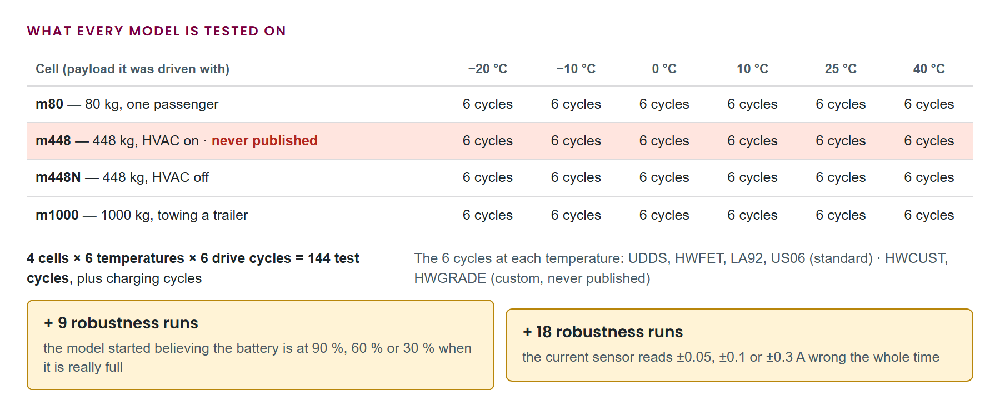

Before each cycle, one hour of its first sample is prepended as **padding**, so that filters and recurrent networks (models that carry state from one sample to the next) reach steady state before the scored portion begins; the padding is excluded from all metrics. A short **validation run** on one cycle precedes the full evaluation, so that a defective model fails within seconds rather than after forty-five minutes. In total an evaluation comprises 195 runs: the 144 drive cycles, the charging profiles, and 27 robustness runs.

### 5.3 From per-cycle errors to one score

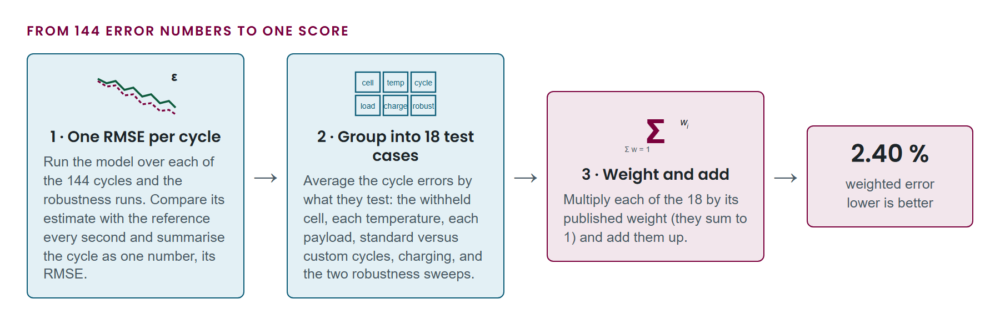

The leaderboard score is the weighted sum of the eighteen test-case errors, where $\mathrm{RMSE}_i$ is the mean RMSE of the cycles in test case $i$ and $w_i$ its published weight:

$$
E = \sum_{i=1}^{18} w_i\,\mathrm{RMSE}_i, \qquad \sum_{i=1}^{18} w_i = 1 \tag{5.2}
$$

The weights are fixed and published:

- Seven categories carry a weight of 0.1 each: the withheld cell, the open cells, charging, standard cycles, non-standard cycles, the incorrect-initial-SOC perturbation and the current-offset perturbation.
- The four payload conditions together carry 0.2.
- The six temperatures together carry 0.1.
- The all-cells case is reported on every scorecard but carries a weight of zero, since every other case is a subset of it and a non-zero weight would count each cycle twice.

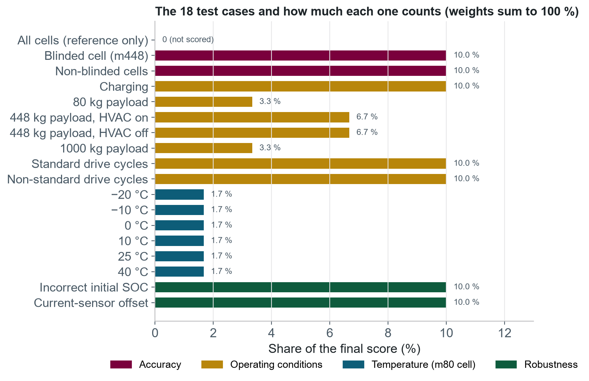

Each test case carries, besides its label, a plain-language *chart* name (Payload 448 kg HVAC on, Standard cycles, Incorrect initial SOC, Current-sensor offset, and so on) that the error-by-test-case chart, the comparison page and the PDF use on their axes, so that a reader never has to decode a test number.

### 5.4 Auxiliary quantities

**Complexity** is reported on a scale from 1 to 10 and addresses the question of whether a model could run on an embedded battery controller. It is the model's execution time per sample relative to a Coulomb counter measured on the same machine in the same language. It is displayed on the leaderboard but has no effect on ranking.

**Peak RAM** and **model size** (Section 3.5) are the two resource measures the laboratory asked for in October 2026. Neither enters the score.

A **suspicious** flag is raised when the mean error exceeds 25 %. The original tool suppressed such results; this implementation records them, e-mails the administrators as a security event, and leaves the decision to a person.

### 5.5 Outputs

Five artefacts leave the sandbox and are written to the database and the file store:

- the eighteen metrics and the weighted score;
- one record per cycle with its RMSE, mean absolute error and maximum error;
- down-sampled traces of thirteen representative cycles, the robustness runs and the model's worst cycle, down-sampled by a method that preserves every extremum so that the plotted trace always agrees with the reported maximum error;
- the per-start and per-offset RMSEs behind tests 10 and 11, which the Charts tab plots;
- a `.mat` file containing every run at full resolution, with each series stored as a 16-bit integer in hundredths of a percent.

Both trace outputs omit one series: the reference state of charge of the withheld m448 cell. Its error series is present, which carries the same information about the model, but the reference itself would be the answer key and is never written. The two labels of test 10 were renamed from "wrong" to "incorrect" initial SOC in October 2026; results evaluated before then still store the old wording and are rewritten on display, so old and new results read the same.

**Files to open:** [pipeline.py](../../evaluator/python/socbench_eval/pipeline.py) (`score`, `complexity`, `write_full_traces`) → [runner.py](../../evaluator/python/socbench_eval/runner.py) → [Run_Model.m](../../matlab/Run_Model.m) → [test-cases.ts](../../src/lib/test-cases.ts) → [traces.ts](../../src/lib/traces.ts).

---

<a id="part-6"></a>
## 6. The data model

> **In this chapter.** The tables on which every other component operates, the two conventions that keep them consistent, and the single schema file that defines them.

Every operation described in Chapters 4 and 5 reads or writes rows in this database. A user owns submissions. Each submission has exactly one queue entry, at most one current result, and an append-only history of every change made to it. Further tables hold contests, worker heartbeats, evaluation settings and the administrative activity log. One file, the Prisma schema, defines all of them, and both the website and the worker are generated from it.

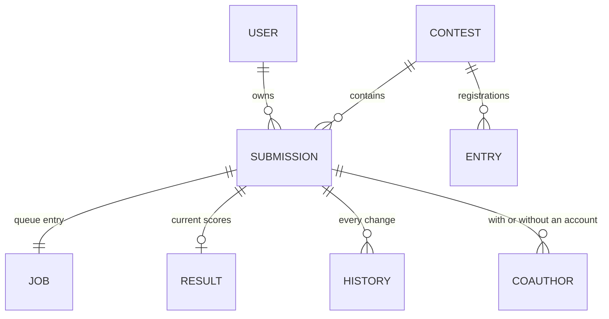

Figure 6.1. The core tables. Each line reads as "has": a user has many submissions; a submission has exactly one job and at most one result.

Two conventions apply throughout:

- **Cascading deletion.** Deleting a user removes that user's submissions, jobs, results and history, so no orphaned rows can exist.
- **Append-only history.** Score revisions, weight changes and administrative events are never modified after they are written, so any past state can be reconstructed.

The `Submission` row has grown three groups of columns since the first version, each the subject of a section above:

- **Authorship**: a display credit (`creditName`, `creditAffiliation`, a photo) that replaces the owner wherever the model is shown while the owner keeps the permissions, and `ownerDisplay`, which places the uploader first, last or nowhere in the author list. Co-author rows may have no account, in which case they carry a name and affiliation themselves.
- **Description**: `paperUrl`, `codeUrl`, and the storage keys and file names of the diagram and the write-up.
- **Files**: `shareFiles`, `fileSize` (zipped) and `unpackedSize`; and `isLegacy` with `legacySource` for scores recorded from before the platform existed.

Several tables stand outside the diagram:

- `WorkerHeartbeat`: one row per worker, refreshed every fifteen seconds with its load, supported languages, code revision, MATLAB and Python versions, whether the withheld data is present, and its most recent console lines.
- `EvalSettings`: a single row of timeouts and the daily submission limit, editable by administrators.
- `ScoringConfig`: weight overrides; the most recent row is authoritative.
- `AdminEvent`: the administrative activity log, including the worker-health state.
- `RateLimitHit`: counters supporting the rate limits of Chapter 7.
- `ContactMessage`: messages received through the contact form.
- `DryRun`: test runs, with their own queue, status and log; never on the leaderboard.

Column-level detail is given in the appendix.

**Files to open:** [prisma/schema.prisma](../../prisma/schema.prisma). A single top-to-bottom reading is the most efficient introduction to the system.

---

<a id="part-7"></a>
## 7. Accounts and security

> **In this chapter.** Authentication and session handling, the reason e-mail verification requires an explicit action, the layered controls that contain a hostile submission, and the security test suite that exercises them.

### 7.1 Why verification requires a button

Corporate mail-security gateways follow every link in an incoming message before the recipient opens it. When the verification link itself performed the verification, these gateways consumed the single-use token and the recipient found it already invalid. The current design separates the two steps:

1. The link in the e-mail leads to a page and changes nothing.
2. The account is verified only when the person presses the **Confirm** button on that page.

In Figure 7.1 the gateway's visit is the third message; the account's state does not change until the person acts.

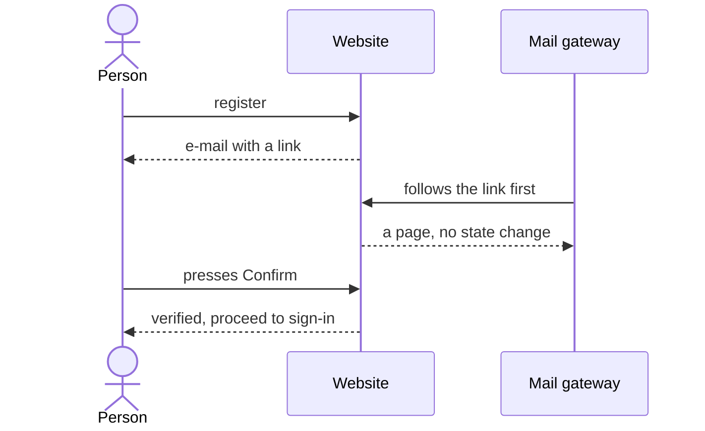

Figure 7.1. Verification is robust to mail gateways because following the link has no side effect.

### 7.2 Authentication and sessions

Sign-in follows four rules:

1. **Attempt limits.** An account may attempt sign-in ten times per fifteen minutes, and a network address forty times, after which further attempts are refused for the remainder of the window.
2. **Password storage.** Passwords are stored as **bcrypt** hashes, a deliberately slow one-way function: a single verification is imperceptible, but an exhaustive guessing attack is impractical.
3. **Sessions.** A successful sign-in issues a signed **session token** held in a browser cookie and valid for fourteen days. Requests are authenticated by verifying the signature, without a database lookup.
4. **Authorisation.** Routes under `/submit`, `/profile` and `/admin` redirect unauthenticated visitors before rendering, but this is a convenience only. The authoritative check is repeated inside every server action.

### 7.3 Containing a hostile submission

Secrets are held in exactly four locations: the web host's settings file (`/etc/socbench/web.env`, readable by root and the service account), the worker's settings file (`/etc/socbench/worker.env`, readable by the service account alone), the worker's MATLAB identity token beside it, and one GitHub repository secret for the health check. They appear in no repository file, container image, log or e-mail. The remaining threats, and the control that addresses each, are set out in the table below.

| Threat | Control |
|---|---|
| The model exfiltrates the withheld data | The container has read access (it must) but no network interface, and is destroyed after the run |
| The model attacks the host | Read-only filesystem, no capabilities, CPU and memory limits, execution as an unprivileged user |
| The model reads the worker's secrets | The container does not inherit the worker's environment; the nonce and the MATLAB licence token arrive on standard input and are removed before the model is imported |
| The model forges its own result | The model runs in a separate process; a results file without the per-run nonce is rejected, the attempt fails, and the administrators are alerted |
| The site leaks the answer key | The reference state of charge of the m448 cell is never written to a trace file, a chart, a download or the PDF; the maintenance scripts that purged older traces are in `scripts/` |
| A decompression bomb or a path-traversal entry | Limits on entry count, unpacked size and compression ratio; no sub-directories; no `..` components; checked in the web tier and again in the evaluator |
| A disguised attachment | A diagram or write-up is accepted only if its first bytes are those of PNG, JPEG, WebP or PDF, within fixed size limits |
| The model never terminates | A timeout enforced both inside and outside the container |
| Queue flooding | Three submissions per day and five test runs per hour per account; shared-package downloads are rate-limited and logged |
| Password guessing | bcrypt hashing and the attempt limits above |
| Account enumeration | Password-reset and resend-verification requests respond identically whether or not the address exists |
| A compromised administrator removes the others | Administrators cannot be deleted until demoted, and no user can change their own role; every administrator is told of every role change |

Browser defences complete the picture: a content security policy that allows scripts from this host and Google Analytics only, HTTP strict transport security, `frame-ancestors 'none'`, and no server banner. Search engines index the public pages only; sign-in, registration, profiles, submission and administrative routes are excluded by the robots rules and by page-level `noindex` directives.

### 7.4 The security test suite

Before the public launch the platform was tested against itself. A `security-tests/` directory of five self-contained harnesses, each with a findings file, is kept in the laboratory's working copy and excluded from the public repository, because its payloads are working attacks:

1. **Exfiltration**: can a submission smuggle a planted secret out through its predictions, its timings or its output? (A synthetic secret stands in for the answer key; the real file is never involved.)
2. **Escape**: can submitted code break container isolation through the network, capabilities, the filesystem or the process table?
3. **API**: a black-box probe of the live site's authorisation, token endpoints and headers.
4. **Score tampering**: can a submission forge or tamper with its recorded score?
5. **Denial of service**: infinite loops, fork bombs, disk filling, and the memory, process and CPU caps, run only against a disposable local sandbox.

Two findings were real and were fixed at the root: a model could write a complete results file and exit with a perfect score (hence the separate process and the nonce), and the full-resolution traces of every result served the withheld cell's reference state of charge to anyone (hence the omission in Section 5.5 and the purge of the stored files). Exfiltration, escape, denial of service and the live API surface produced no exploitable finding. The suites exit non-zero when a finding survives, so they can be re-run after any change to the sandbox.

**Files to open:** [auth.ts](../../src/lib/auth.ts) → [middleware.ts](../../src/middleware.ts) → [(auth)/actions.ts](../../src/app/(auth)/actions.ts) → [rate-limit.ts](../../src/lib/rate-limit.ts) → [python-evaluator.ts](../../src/evaluator/python-evaluator.ts) → [strip-blinded-timeseries.ts](../../scripts/strip-blinded-timeseries.ts).

---

<a id="part-8"></a>
## 8. Administration and monitoring

> **In this chapter.** The administrative interface, the procedure for revising scoring weights without re-evaluating any model, the notification model, the automated check that detects an unreachable worker, and the usage analytics.

### 8.1 The administrative pages

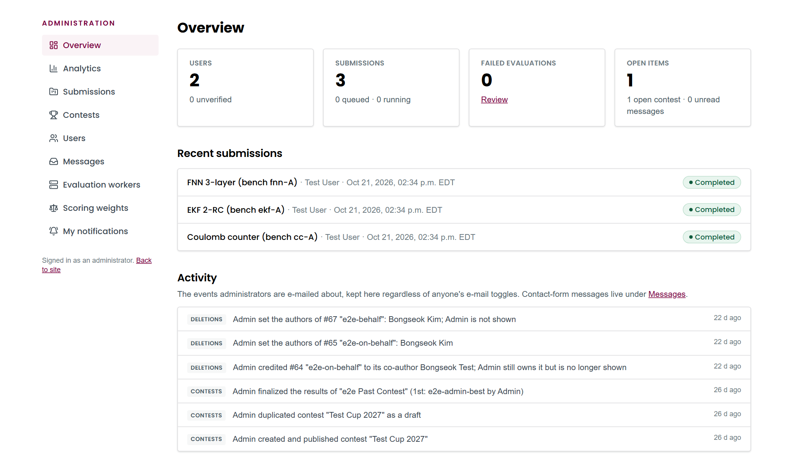

The left-hand navigation enumerates the interface:

- **Overview**: summary counts, recent submissions and the activity log.
- **Analytics**: how the public site is used, read back from Google Analytics (Section 8.5).
- **Submissions**: moderation (private, hidden, delete, each with a written reason that is e-mailed to the authors), retry, bulk deletion, live progress of running evaluations, editing of a submission's name, description, links and authorship, and recording of legacy scores.
- **Contests**: creation with a step rail and readiness checklist, scheduling, duplication, closure and the finalisation of results.
- **Users**: verification, role assignment and deletion, plus the list of named authors credited without an account.
- **Messages**: the contact-form inbox.
- **Evaluation workers**: every registered machine with its load, code revision, Python and MATLAB versions, licence expiry and whether the withheld data is present; the queue; recent failures; the evaluation limits; and a load test that queues several copies of an example in one batch so that the resource charts show the machine under genuine parallel load.
- **Scoring weights**: the subject of Section 8.2.
- **My notifications**: each administrator's own e-mail preferences (Section 8.3).

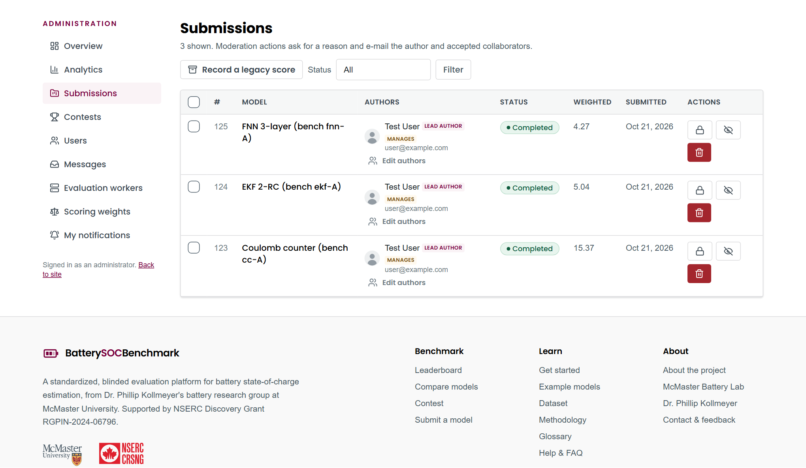

Every administrative action re-verifies the caller's role before proceeding, and each is subject to a safeguard. The safeguards are tabulated in the appendix.

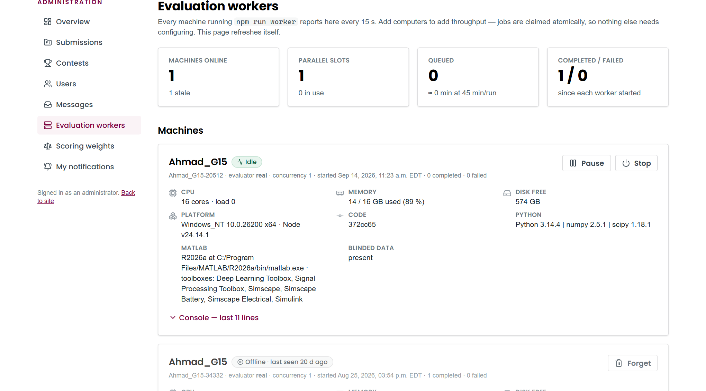

### 8.2 Revising the weights

An administrator edits the eighteen weights, which must sum to one, previews how many stored scores would change, and saves with a written justification. Every stored result is then re-scored from its persisted per-test metrics; no model is re-executed, since the metrics were retained and the packages were deleted. Authors may optionally be notified of the previous and revised scores with a regenerated PDF. The superseded weights remain in the history.

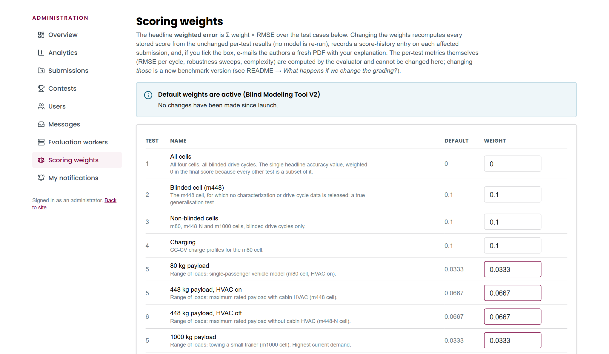

### 8.3 Notifications

Every administrative event follows two paths, one unconditional and one configurable:

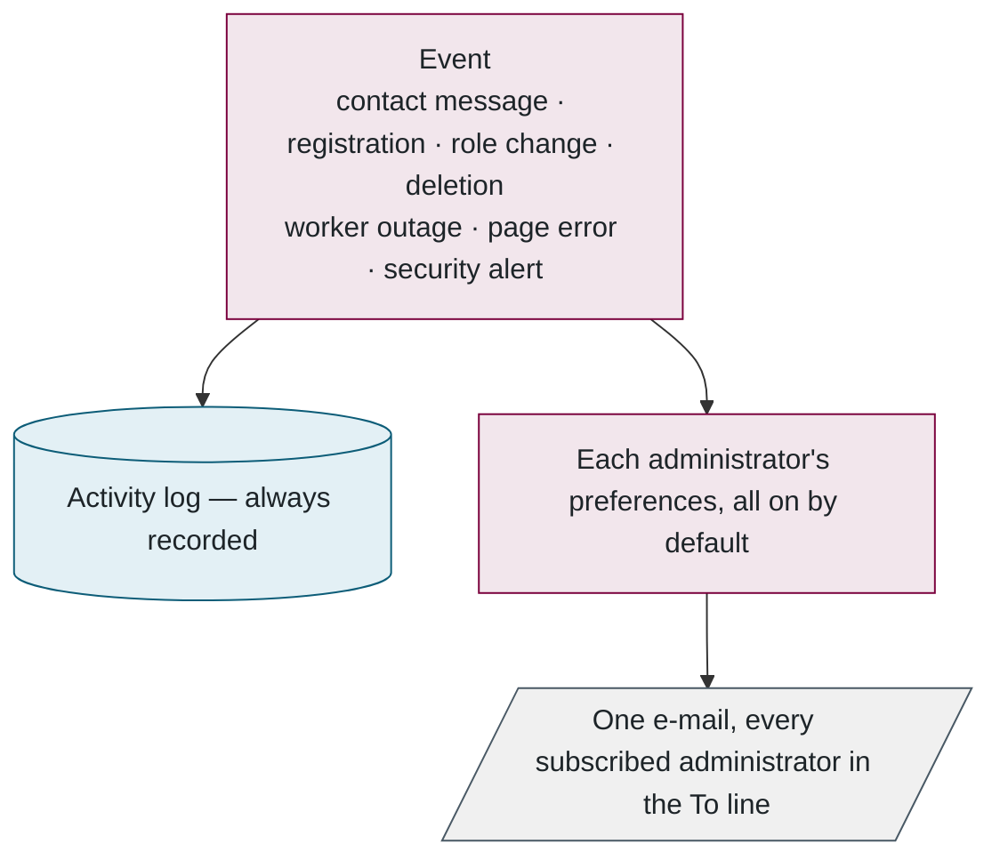

Figure 8.5. The activity log is the record; e-mail is a copy that each administrator may switch off per category.

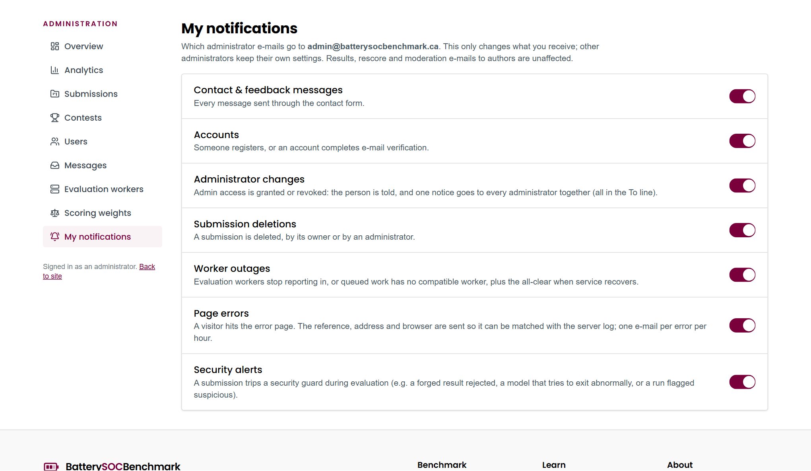

Seven event classes exist: contact and feedback messages, accounts (registration and verification), administrator changes, submission deletions, worker outages, page errors and security alerts. Every class is on for every administrator unless that administrator switches it off, and one message goes to all of them together, with every recipient in the To line, so each can see who else was told. When administrator rights are granted or revoked, the person concerned is also told directly. The **page errors** class is fed by the site's own error page, which reports itself (reference, address, browser) the moment it renders, throttled to one e-mail per error per hour; a page left open across a deployment reloads itself once instead, and a lost connection on the visitor's side is shown as such and not reported. Every send is logged with a masked recipient and its outcome, so a delivery question can be answered from the server journal.

A note on a property of the former hosting platform, retained because the code still carries its remedy: a serverless request is frozen the instant a response is returned, so any e-mail dispatched asynchronously without being awaited was silently lost. Every such dispatch is wrapped in `after()`, which keeps the request alive until the send completes; on the long-running Node.js process of the Arbutus host it is harmless and still correct.

### 8.4 The outage monitor

The monitor was introduced after an incident in which the worker remained healthy but was unable to reach the database for ten hours, with no indication to anyone. The web tier is the one component that can always observe both the database and the mail service, so it performs the check. A GitHub Actions workflow calls a health endpoint on the site every ten minutes; the endpoint evaluates two conditions and sends an e-mail only when the answer changes.

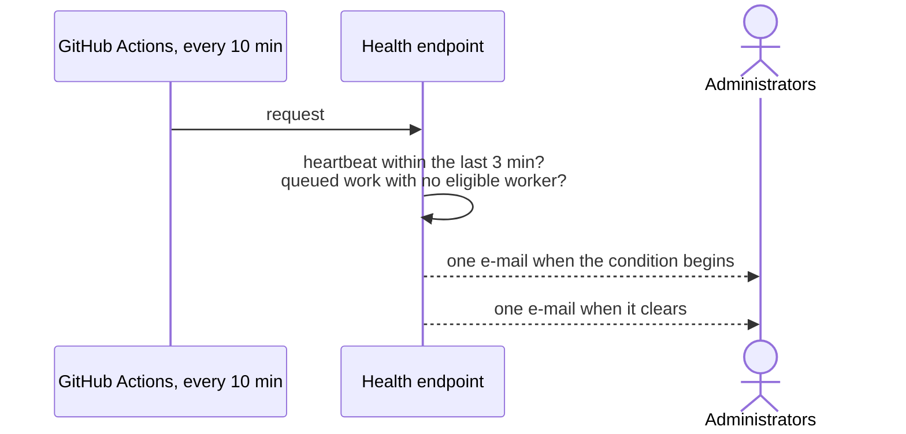

Figure 8.7. One alert per outage and one all-clear. The state is recorded in the activity log, so it is also visible on the site.

The workflow itself stays green during a worker outage, because the endpoint answers and handles the e-mail; a red run means the website did not answer, which GitHub reports to the repository owner on its own.

### 8.5 Analytics

The public pages report page views, outbound link clicks and opted-in button clicks to a Google Analytics 4 property, and the worker reports evaluation outcomes to the same property through the Measurement Protocol, so that the laboratory can see how the benchmark is used. Nothing is reported until a measurement ID is configured, and a development build uses a separate ID so that local clicks never land in the real property. **Admin → Analytics** reads the property back through the Data API with a read-only service account: people, visits and page views over 7 and 28 days, who is on the site now, the most-viewed pages, how people arrived, countries, devices and every event.

**Files to open:** [admin/actions.ts](../../src/app/(admin)/admin/actions.ts) → [admin-notify.ts](../../src/lib/admin-notify.ts) → [mail.ts](../../src/lib/mail.ts) → [worker-health/route.ts](../../src/app/api/ops/worker-health/route.ts) → [client-error/route.ts](../../src/app/api/ops/client-error/route.ts) → [google-analytics.ts](../../src/lib/google-analytics.ts).

---

<a id="part-9"></a>
## 9. Infrastructure

> **In this chapter.** The two machines on which the platform runs and how each updates itself, how MATLAB is licensed inside a container, what runs before a push, how the system is run on a development machine, and the self-hosted arrangement and the migration that led to it.

### 9.1 The deployed services

Both deployed programs run on Ubuntu virtual machines in the Alliance's Arbutus cloud and update themselves the same way:

- **The web host** (`socbench-web`) carries Caddy, the Next.js site, PostgreSQL and the package store. Every ten minutes it fetches the repository and, if `main` has moved, installs dependencies if they changed, applies additive schema changes, builds the site beside the running one and swaps them, so that no half-built page is ever served.
- **The worker** (`socbench-eval`) carries Docker, the two sandbox images and the withheld data. Every ten minutes it fetches the repository and, if anything changed, rebuilds only the affected components and restarts the worker, but only when no evaluation is in progress; otherwise it defers to the next interval.

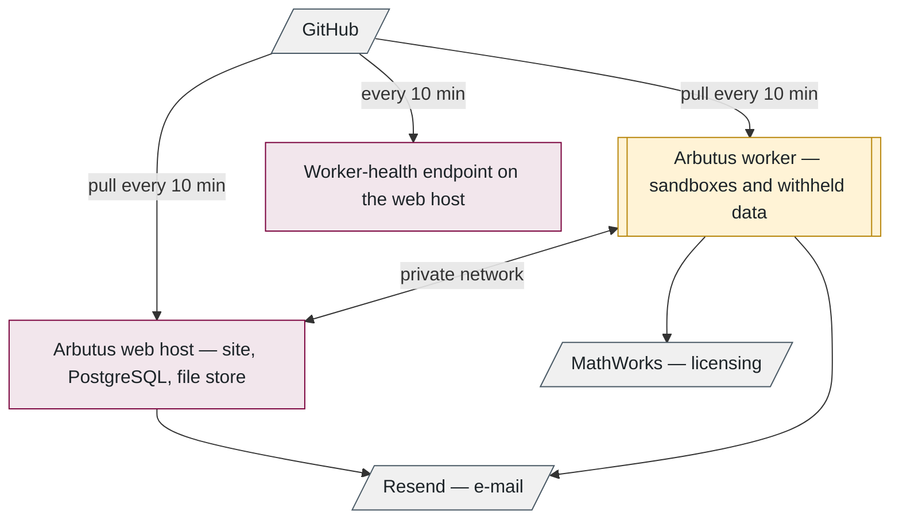

Figure 9.1. The three programs of Chapter 2 in their hosting context. Nothing but GitHub, MathWorks and the mail provider lies outside the research cloud.

A change therefore reaches production by being merged to `main`: the web host adopts it within ten minutes, and the worker within ten minutes of its next idle moment. When a change touches the database schema the web host must update first, since it is the one that applies the schema; the usual practice is to run the two update scripts by hand, web then worker, immediately after the push (Chapter 10).

### 9.2 The worker machine

A single provisioning script prepares the machine. It installs and configures:

- Docker, which provides the sandboxes;
- Node.js, the runtime for the worker;
- a service account with no interactive login, whose sole purpose is to run the worker;
- a checkout of the repository using a deploy key with read-only access;
- a hardened systemd service that keeps the worker running and returns in-flight jobs to the queue on a graceful stop;
- a firewall that admits SSH from the campus network and listed addresses, and nothing else.

Secrets and the withheld data are placed manually after provisioning. They are owned by the service account and readable by no other user. The worker reaches the database over the private network and the package store over HTTPS with its bearer token; it has no public service of its own.

### 9.3 MATLAB in a container

MATLAB runs inside MathWorks' own container image, with Control System Toolbox added by MathWorks' package manager during the image build, and is licensed through the laboratory's MathWorks account rather than a licence server. A one-time interactive sign-in produced an identity token valid for one year, which is stored on the virtual machine. Before each evaluation the worker exchanges it for a 24-hour access token, and only that short-lived token is passed into the container, on standard input, as Figure 9.2 shows:

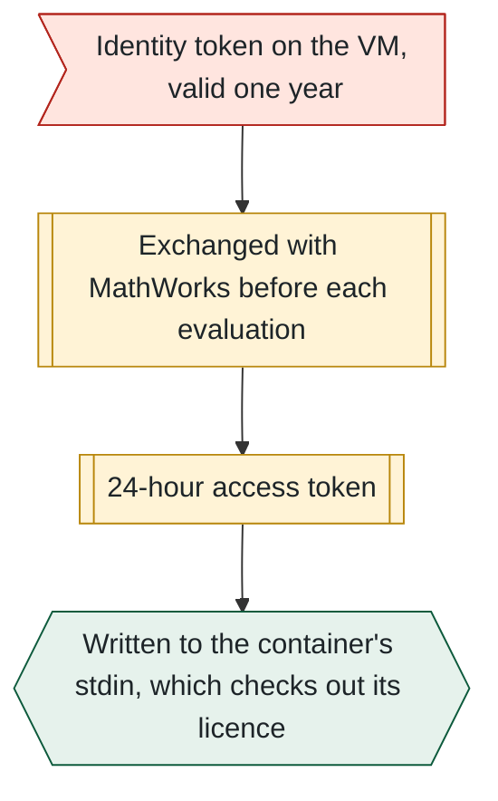

Figure 9.2. The licensing chain. The long-lived credential never enters the sandbox.

The licence check-out needs to reach MathWorks, so a MATLAB container is started with a bridged network interface instead of none; it is the one relaxation of the sandbox, and restricting that interface to the licensing hosts alone is recorded as open work in the internal runbook. The identity token's expiry date is shown on the workers page; renewal repeats the sign-in.

### 9.4 Checks before a push

Two automated checks protect the site:

- A **pre-push hook** in the repository runs a production build and a Playwright pass over every public page (and a real results page and the comparison page) whenever a push touches the web tier, and refuses the push if any page fails to render, throws in the browser or returns a server error. It runs against the developer's local database.
- The **health workflow** of Section 8.4 runs on GitHub every ten minutes.

There is no separate build server: the two machines build the code themselves on arrival.

### 9.5 Running the system locally

The same code runs on a development machine with different configuration. There is no simulated evaluator: a developer's worker runs the real evaluation pipeline, which requires the withheld data and the sandbox image. The repository README lists the commands required, and the configuration differs from production in four respects:

- a local PostgreSQL instance in Docker on port 5433;
- uploaded files stored under `uploads/` on the local disk, with the worker on the same machine reading them directly;
- e-mail delivered to a throw-away test inbox rather than to real addresses;
- a **seed** script that populates the empty database with one administrator account, one test user and one sample contest, and nothing else.

**Files to open:** [provision-arbutus-worker.sh](../../scripts/provision-arbutus-worker.sh) → [vm-update.sh](../../scripts/vm-update.sh) → [Dockerfile.matlab](../../evaluator/Dockerfile.matlab) → [.githooks/pre-push](.githooks/pre-push) → [.env.example](../../.env.example).

### 9.6 The web host and the migration

The website, the database and the uploaded files share one machine, the **web host**, prepared by one provisioning script that installs and configures:

- Node.js and a hardened systemd service that runs the website on a local port;
- PostgreSQL, listening on the local machine and on the private network only;
- Caddy, a web server that terminates HTTPS and obtains and renews its certificate without intervention;
- a firewall that admits SSH, HTTP and HTTPS from anywhere, and PostgreSQL from the worker's private address alone;
- a nightly database dump retained for fourteen days;
- the self-update timer described in Section 9.1.

The database password and the session secret are generated on the machine during provisioning and are never transmitted elsewhere.

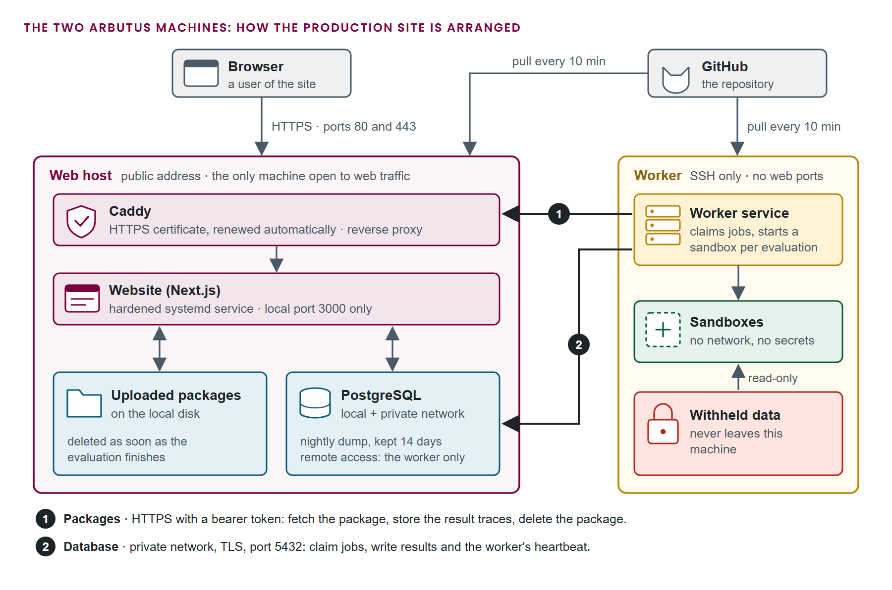

Two machines cannot share a local disk, so package storage has the *remote* mode described in Section 4.2:

1. The website saves an uploaded package to its disk and records the key in the database, exactly as it does on a development machine.
2. The worker claims the job and requests the package from the internal endpoint, presenting the shared token in the request header.
3. After the evaluation the worker uploads the result traces through the same endpoint and, unless the package is shared, deletes it.

The endpoint does not exist unless the token is configured, compares the token in constant time, and accepts only keys of the form the website itself generates, so a request cannot name an arbitrary file.

**The migration.** The platform was launched on commercial free tiers (the website on Vercel, the database and file bucket on Supabase) with the worker already on Arbutus. The move to the arrangement above was carried out on 21 September 2026 in four steps, each a script in the repository: the hosted database was copied into the web host's PostgreSQL with row counts compared table by table; the worker's configuration was repointed to the new database and the remote storage mode; the DNS records were changed and the web host obtained its certificate and rebuilt with the public address; and after a period of parallel running the hosted services were retired on 2 October 2026. One residue remains visible: result traces of ten submissions evaluated before the move were never copied from the former bucket, so those results show no time-series plots and cannot be overlaid on the comparison page.

**Files to open:** [provision-arbutus-web.sh](../../scripts/provision-arbutus-web.sh) → [web-update.sh](../../scripts/web-update.sh) → [storage.ts](../../src/lib/storage.ts) → [internal storage route](../../src/app/api/internal/storage/route.ts) → [cutover-import-db.sh](../../scripts/cutover-import-db.sh).

---

<a id="part-10"></a>
## 10. Maintenance reference

The most common maintenance tasks and where each is performed. Anything not listed can be located from the *Files to open* entries of the preceding chapters.

| Task | Procedure |
|---|---|
| Deploy a change | Merge to `main`; both machines adopt it within 10 min. To deploy at once, or when the schema changed: on the web host `sudo /opt/socbench/scripts/web-update.sh`, then on the worker `sudo bash /opt/socbench/scripts/vm-update.sh`, in that order |
| Change a timeout or the daily submission limit | Admin → Evaluation workers. No deployment; effective within 15 s |
| Revise the scoring weights | Admin → Scoring weights: edit, preview, save with a justification, optionally notify authors |
| Change the scoring *computation* | Edit `pipeline.py`; re-run the reference models and confirm that only the intended scores changed; increment the benchmark version in `socbench_eval/__init__.py` and `benchmark-version.ts`; existing results become "legacy" and their authors are invited to resubmit |
| Add a metric | Add a column in `schema.prisma`, an entry in `test-cases.ts` (label and chart name), and its computation in `score()`; the scorecard, charts, PDF and CSV pick it up; confirm the weights still sum to 1 |
| Add a MATLAB toolbox | Add the product to the `mpm install` line of `Dockerfile.matlab`; the worker rebuilds the image on its next update (about half an hour); verify with a test run of a package that uses it |
| Add a worker machine | Provide the withheld data and `worker.env`, then `npm run worker`; the machine registers itself and begins claiming jobs |
| Rotate a secret | Rotate at the source, update `/etc/socbench/web.env` and `/etc/socbench/worker.env`, run the update script with `--force` on the web host and restart the worker |
| Renew the MATLAB licence (annually) | The Workers page shows the expiry; repeat the interactive sign-in and `matlab-mhlm-setup.sh` |
| Grant administrator rights | Admin → Users → Make admin, or add the address to `ADMIN_EMAILS`; effective on the user's next request; every administrator is e-mailed |
| Credit a model to someone else, or fix its description | Admin → Submissions → Edit authors / Edit details (name, description, links) |
| Record a score from before the platform | Admin → Submissions → Record a legacy score |
| Re-run the security suite after a sandbox change | `python security-tests/<suite>/run.py` in the laboratory's working copy; each exits non-zero when a finding survives |
| Read the server logs | Web host: `journalctl -u socbench-web`, `-u socbench-web-update`, `-u caddy`. Worker: `journalctl -u socbench-worker` (the last 200 lines are on the Workers page) |

---

<a id="part-11"></a>
## 11. A ten-minute demonstration

1. **Leaderboard.** Rank, weighted error, complexity, model size and peak RAM. Note that every figure is an error and that lower is better, and that the *files* badge marks a model whose package can be downloaded.
2. **One result.** The three cards, the scorecard summing to the score, the Charts tab with the donut and the gallery, the withheld-cell panel that shows the error only, the About tab and the PDF report.
3. **Compare.** Three models side by side, then the worst case of one overlaid with the others.
4. **Submission.** Run a test on a reference package (seconds), then submit it with a diagram and a paper link; observe the queue position and the progress indicator.
5. **Admin → Evaluation workers.** The machine that claimed the job: languages, load, console and licence expiry.
6. **Source, in this order.** `schema.prisma` → `claimJob` in `run-job.ts` → the `docker run` invocation and the nonce in `python-evaluator.ts` → `score()` in `pipeline.py` → `Run_Model.m`.
7. **Conclude with the rule.** The web tier never executes submitted code and never has access to the withheld data.

---

<a id="part-12"></a>
## 12. Glossary

### Battery terms

| Term | Meaning |
|---|---|
| **SOC, state of charge** | The fraction of usable capacity remaining, 0–100 %. It cannot be measured directly and is estimated from current, voltage and temperature. |
| **BMS** | Battery management system: the vehicle electronics that execute the estimator, one sample at a time. |
| **Cell** | One physical battery. Four Tesla 2170 cells are used, named for the simulated vehicle payload with which they were cycled: `m80`, `m448`, `m448N`, `m1000`. `m448` is withheld in its entirety. |
| **Drive cycle** | A standard speed profile converted to the current a cell delivers. UDDS (urban), HWFET (highway), LA92 and US06 (aggressive), HWCUST and HWGRADE (laboratory-designed, unpublished). |
| **Open / withheld data** | Open data is published for model development; withheld (blinded) data is reserved for scoring. `blind_data.mat` is the reference. |
| **Coulomb counting** | Integration of current over time: the simplest estimator, and the reference for the complexity scale. |
| **EKF / UKF** | Extended and unscented Kalman filters: model-based estimators that fuse a cell model with measurements. |
| **FNN / LSTM / GRU / Transformer** | Neural-network estimator architectures. |
| **RMSE / MAE / maximum error** | Root-mean-square, mean-absolute and worst single-sample error, in percentage points of SOC. |
| **Test case** | One of the eighteen scoring categories, each with a published weight and a plain-language chart name. |
| **Weighted error** | The leaderboard score: the sum over test cases of weight × RMSE. |
| **Robustness run** | A run with a deliberately incorrect initial SOC, or with a constant offset added to the current. |
| **Padding** | One hour of the first sample prepended to each cycle so that stateful models reach steady state. |
| **Complexity** | Execution time per sample relative to a Coulomb counter, binned 1–10. Informational only. |
| **Model size / Peak RAM** | The uncompressed total of the files in the package; the peak memory of the model process in the sandbox. Informational only. |
| **Test run (dry run)** | An evaluation on open data from the submission page; not recorded on the leaderboard. |
| **Package** | The uploaded archive: `Model.py` or `Model.m`/`Model.p` together with parameter files. Deleted after evaluation unless shared. |
| **Legacy entry** | A score recorded by an administrator from before the platform existed: no package, no re-evaluation, a badge. |

### Software terms

| Term | Meaning |
|---|---|
| **Repository / git / GitHub** | The source code with its full change history, hosted on GitHub. |
| **Container / Docker / image** | An isolated execution environment; the runtime that creates it; the template from which it is created. |
| **Sandbox** | A container with the network disabled, a read-only filesystem and no privileges. |
| **Nonce** | A random value issued per run, stamped into the result by the evaluator and unknown to the model; a result without it is a forgery. |
| **Database / table / row** | PostgreSQL stores all persistent state as tables of rows. |
| **Prisma** | The typed database client; one schema file defines every table. |
| **Server Component / Server Action** | A page rendered on the server from the database; a form handler executed on the server. There is no separate API layer. |
| **Package store** | The web host's directory of uploaded files, reached by the worker through the internal storage endpoint with a bearer token. |
| **Session token / JWT / cookie** | A signed token held by the browser after sign-in, proving identity on each request. |
| **bcrypt** | A deliberately slow one-way hash function for passwords. |
| **Rate limit** | A cap on the number of attempts within a time window. |
| **Queue / job / worker / heartbeat** | Pending work; one unit of it; the process that performs it; the process's periodic liveness record. |
| **Compare-and-swap** | An update applied only if the row is unchanged since it was read; the mechanism by which two workers never claim the same job. |
| **Environment variable / `.env`** | Configuration and secrets supplied to a program from outside its code. |
| **VM / Arbutus / systemd** | A cloud virtual machine; the Alliance's cloud at the University of Victoria; the Linux service manager. |
| **Caddy** | The web server in front of the site, which terminates HTTPS and renews the certificate. |
| **Resend** | The mail provider through which both machines send e-mail from the site's domain. |
| **mode 600** | A file readable and writable only by its owner. |

### Key figures

144 test cycles (4 cells × 6 temperatures × 6 cycles) · 195 runs per evaluation · 18 test cases with weights summing to 1 · 3 submissions per day and 5 test runs per hour · 12-hour evaluation limit, 10-minute test-run limit · worker polls every 2 s, heartbeat every 15 s · a lock expires after 30 min, 2 attempts per job · 50 MB upload limit · description 80–2000 characters · diagram 3 MB, write-up 10 MB · both machines update within 10 min of a push.

---

<a id="part-13"></a>
## 13. Appendix: reference tables

### Tools

| Tool | Role | Rationale |
|---|---|---|
| TypeScript, Node.js | Language and runtime for the website and the worker | One typed language for both |
| Next.js 15, React 19 | Web framework | Pages, forms and small APIs in one project |
| Tailwind CSS, Radix UI | Styling; accessible dialogs, menus and tooltips | Rapid development; McMaster colours as design tokens |
| Recharts, TanStack Table | Charts; the leaderboard's headless table | SVG charts with export; sorting and column selection |
| zod | Form validation | One rule set applied in the browser and on the server |
| Auth.js, bcryptjs | Sessions; password hashing | No third-party identity provider required |
| Prisma, PostgreSQL | Database client; the database, on the web host | One schema file; no managed tier |
| nodemailer, Resend | E-mail transport; the mail provider | Provider-independent code; a verified sending domain |
| pdfkit, KaTeX, react-markdown | The PDF report; equations and Markdown on the documentation pages | Vector PDFs without a browser |
| Python 3.12, numpy, scipy | The evaluation pipeline | Exact, fast, licence-free scoring; reads `.mat` files |
| MATLAB R2026a | Executes `.m`/`.p` models only | Inside MathWorks' container image, licensed online |
| Docker | The sandbox | Isolation of untrusted code |
| Caddy | HTTPS in front of the site | Automatic certificates |
| Playwright | Browser tests before a push; the manual's screenshots | Catches rendering failures that type-checking cannot |
| Google Analytics 4 | Usage analytics, off until configured | Read back on Admin → Analytics |
| Arbutus, GitHub Actions | The two machines; the ten-minute health check | All on research or free tiers |

### Environment variables

| Group | Variables |
|---|---|
| Database | `DATABASE_URL`, `DIRECT_URL` |
| Website | `AUTH_SECRET`, `AUTH_URL`, `NEXT_PUBLIC_SITE_URL`, `ADMIN_EMAILS`, `CRON_SECRET`, `OPS_HEALTH_TOKEN`, `SUBMISSIONS_PER_DAY` |
| Mail | `SMTP_HOST`, `SMTP_PORT`, `SMTP_USER`, `SMTP_PASS`, `MAIL_FROM`, `ADMIN_NOTIFY_EMAIL` (a fixed list that overrides the per-administrator preferences) |
| Storage | `STORAGE` (local / supabase / remote), `UPLOAD_DIR`, `MAX_UPLOAD_MB`, `STORAGE_REMOTE_URL`, `STORAGE_REMOTE_TOKEN`; `SUPABASE_*` for the retired hosted mode |
| Analytics | `GOOGLE_ANALYTICS_ID`, `GOOGLE_ANALYTICS_DEV_ID`, `GOOGLE_ANALYTICS_API_SECRET` (worker), `GOOGLE_ANALYTICS_PROPERTY_ID`, `GOOGLE_ANALYTICS_SERVICE_ACCOUNT_FILE` (web host) |
| Worker | `SOCBENCH_BLIND_DATA`, `SOCBENCH_PYTHON`, `MATLAB_BIN`, `WORKER_CONCURRENCY`, `WORKER_RUNTIMES` |
| Sandbox | `EVAL_SANDBOX`, `EVAL_SANDBOX_IMAGE`, `EVAL_SANDBOX_MATLAB_IMAGE`, `EVAL_MATLAB_MHLM_FILE`, `EVAL_MATLAB_LICENSE`, `EVAL_MATLAB_NETWORK`, `EVAL_CPUS`, `EVAL_MEMORY`, `EVAL_PIDS` |
| Calibration | `SOCBENCH_CAL_PYTHON`, `SOCBENCH_CAL_MATLAB` |

Every variable is annotated in `.env.example`. Production values exist only in `/etc/socbench/web.env` on the web host and `/etc/socbench/worker.env` on the worker.

### Limits

| Operation | Limit |
|---|---|
| Registration | 5 per hour per address |
| Sign-in | 10 per 15 min per account, 40 per 15 min per IP address |
| Password reset / resend verification | 3 per hour per e-mail address |
| Contact form | 5 per hour per IP address |
| Test runs | 5 per hour (administrators unlimited) |
| Submissions | 3 per rolling 24 h by default, editable 1–100 (administrators exempt) |
| Evaluation / test run | 720 min / 10 min by default; editable 10–1440 and 2–60 |
| Upload | 50 MB zipped |
| Archive | ≤ 500 entries, ≤ 512 MB unpacked, ≤ 256 MB per entry, ≤ 200 : 1 compression ratio, no sub-directories, no symbolic links |
| Model name / description | 50 characters / 80–2000 characters, neither containing an author's name |
| Diagram / write-up | 3 MB PNG, JPEG or WebP / 10 MB PDF, checked by content |
| Page-error e-mails | One per error reference per hour |

### Administrative actions and their safeguards

| Action | Safeguard |
|---|---|
| Moderate a submission | Justification of at least 10 characters; not while RUNNING; contest entries cannot be made private (hide instead); the authors are e-mailed |
| Edit a submission's details or authorship | Only administrators; the no-author-name rule applies; every change is a history entry |
| Bulk deletion | At most 100; RUNNING entries skipped; one activity-log entry; one e-mail per author listing all their removed models |
| Record a legacy score | Headline figures only; badge on the entry; never ranked against current results by mistake |
| Delete a user | Not oneself; not an administrator (demote first); not while the user's work is RUNNING |
| Change a role | Not one's own; the person and every administrator are e-mailed |
| Pause, resume or stop a worker | Applied at the worker's next heartbeat |
| Release a job lock | Behind a confirmation; a live worker would evaluate the job twice |
| Load test | The copies are private and hidden and never reach the leaderboard |
| Evaluation settings | Timeout 10–1440 min, test run 2–60 min, submissions per day 1–100 |
| Scoring weights | Preview required; must sum to 1 |
| Contests | Only one open at a time; results finalised once |

### Principal columns

| Table | Columns of note |
|---|---|
| `User` | `email`, `passwordHash`, `role`, `emailVerified` (a timestamp), profile fields, `adminNotify` preferences, `avatar` |
| `Submission` | `seq` (the visible number), `modelName`, `description`, `paperUrl`, `codeUrl`, `figureKey`, `docKey`, `modelType`, `runtime` (python / matlab), `status`, `version`, `isPrivate`, `isHidden`, `fileKey`, `fileSize`, `unpackedSize`, `shareFiles`, `creditName`, `ownerDisplay`, `isLegacy`, `contestId` |
| `SubmissionCollaborator` | `userId` (null for a named author without an account), `name`, `affiliation`, `acceptedAt`, `inviteToken` |
| `EvaluationJob` | `attempts`, `lockedAt`, `lockedBy`, `log`, `cancelRequestedAt` |
| `EvaluationResult` | `weightedError`, `complexity`, the 18 metric columns, `maxError`, `perCycle`, `timeSeries`, `robustness`, `resourceUsage`, `tracesKey`, `evaluatorVersion` |
| `ScoreRevision` | `kind` (evaluation, reevaluation, failure, rescore, edit, cancelled, legacy), the score and metrics at that moment, `note`, `by`, `log` (the evaluator console of that attempt, administrators only) |
| `WorkerHeartbeat` | `hostname`, `lastSeenAt`, `runtimes`, `busyWith`, `paused`, `command`, machine diagnostics, `gitSha`, `log` |
| `Contest` | `startsAt`, `endsAt`, `registrationEndsAt`, `prizes`, `eligibility`, `maxTeamSize`, `allowedRuntimes`, `winners`, `judgedAt` |
| `DryRun` | its own `status`, lock and `log`; `result` JSON; never touches withheld data, never on the leaderboard |
